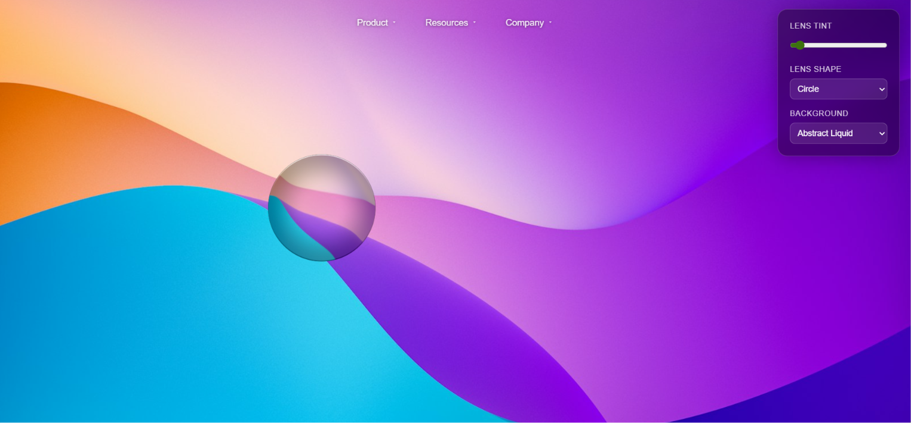

# LiquidWeb



LiquidWeb is a standalone, vanilla JavaScript and WebGL experiment that renders a highly realistic "liquid glass" refraction effect directly in the browser. No external frameworks or 3D libraries are required.

## Features

* **Real-Time WebGL Refraction:** Uses a custom fragment shader to simulate glass thickness, chromatic aberration, and specular edge highlights.
* **Interactive Draggable Lens:** Includes a floating glass element that you can drag around the screen to see the real-time distortion effect over the background.
* **Dynamic Glass UI:** The navigation dropdown menu applies the same physical glass effect over the background, calculating its geometry on the fly.
* **Control Panel:** A built-in UI overlay allows you to:
    * Adjust the darkness/tint of the glass lens.
    * Toggle the lens shape between a perfect circle and a rounded square.
    * Swap between high-resolution, high-contrast backgrounds to test the shader.
* **Zero Dependencies:** Written entirely in vanilla HTML, CSS, and raw WebGL.

## How to Run

Because this project relies on fetching external images (which requires CORS permission) and uses WebGL textures, it is best to run it through a local development server rather than just double-clicking the `index.html` file.

1. Clone or download this repository.
2. Open a terminal in the project folder.
3. Start a local server. If you have Python installed, you can use:
   ```bash
   python -m http.server 8000
   ```
4. Open your browser and navigate to http://localhost:8000