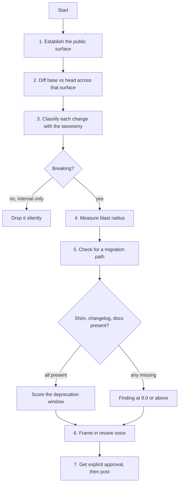

# API Compatibility Review

A specialised lens layered on [`pr-review`](https://github.com/priyank766/OpenSource-SKILL/blob/main/skills/pr-review/SKILL.md). Run the general
procedure first; run this when the diff touches anything a downstream consumer can observe.

**Read first:** [`DETECTION-PLAYBOOK.md`](references/DETECTION-PLAYBOOK.md) ·
[`QUALITY-FILTER.md`](references/QUALITY-FILTER.md) ·
[`REVIEW-VOICE.md`](references/REVIEW-VOICE.md)

> **Where the time goes.** Finding the flaw is the review. The playbook above is the
> general flaw-hunting procedure; this file is the domain-specific lens on top of it.
> Scoring and writing the comment are the last ten minutes, not the work.

**Severity floor: 7.5** — lower than the suite default of 8.0. The asymmetry justifies it.
A noisy comment costs one maintainer thirty seconds. A missed break reaches every
downstream user simultaneously the moment the release publishes, and cannot be un-shipped:
registries are append-only, a yanked version is still in someone's lockfile, and the fix
arrives as *another* release those users must now also adopt. Under that asymmetry, a
false positive is cheap and a false negative is not.

---

## The governing question

> **What breaks for someone who upgrades without reading the changelog?**

Not "is this change reasonable" — most breaks are reasonable. Not "is the new API better" —
it usually is. The only question is what happens to the person who bumps a caret range,
runs their suite, and gets a red build or, worse, a green one with different behaviour.

Everything below exists to answer that one question with evidence rather than intuition.

---

## Why this exists

Compatibility damage is invisible at review time and expensive afterwards. A removed
keyword argument produces a clean diff, a passing CI run, and — three weeks after release —
a stream of issues that all look different and all have the same cause. The maintainer
pays for it in triage, not in review.

### What each role gets out of it

| Role | Time this gives back |
| :--- | :--- |
| **Maintainer** | The surface diff is computed before merge, not reconstructed from bug reports. One pass over `apidiff`/`cargo-semver-checks` output replaces the weeks of issue triage that follow an unnoticed break, plus the emergency patch release and the apology thread. |
| **Contributor** | You find out your change is breaking while you can still design around it, instead of after a maintainer closes the PR with "this can't land before 3.0". |
| **Project owner** | A written, checkable definition of what the project promises. Version numbers start meaning something, and "is this a minor or a major?" stops being decided by whoever cuts the release. |

---

## Procedure



---

## 1. Establish the public surface first

A change is breaking only relative to a contract. Find the contract before judging the
diff; otherwise you will flag internal churn and miss a real break in a file that did not
look public.

```bash
rg -n "semver|semantic version|stability|public API|breaking" README.md docs/ CONTRIBUTING.md
ls docs/versioning.md docs/stability.md POLICY.md 2>/dev/null
cat CHANGELOG.md | head -60        # how have breaks been handled before?
git tag --sort=-v:refname | head   # does this project even bump majors?
```

Then read the language's own marker of intent:

| Ecosystem | Where "public" is declared |
| :--- | :--- |
| Python | `__all__`, absence of a leading `_`, what `docs/` imports, `py.typed` |
| JS/TS | `package.json` `exports` map, generated `.d.ts`, `@public` / `@internal` TSDoc tags |
| Go | Exported identifiers outside any `internal/` directory — the compiler enforces this one |
| Rust | `pub` vs `pub(crate)`, `#[doc(hidden)]`, `#[non_exhaustive]` on enums and structs |
| Java | `public` modifier plus `module-info.java` `exports`, `@Internal` annotations |
| C/C++ | Installed headers only; anything under `src/` or `detail/` is not surface |

`#[non_exhaustive]`, `@internal`, and `internal/` are the project telling you in advance
which changes it reserves the right to make. Respect them — flagging a change the project
explicitly reserved is a false positive, and a costly one for your credibility.

**No stated policy?** Assume anything importable, documented, or shown in a README example
is public, and say so in the review rather than silently assuming it:

> There's no stability policy I could find, so I'm treating anything reachable from
> `import foo` as public — `foo.Client.retries` is used in the quickstart, which is why I
> think dropping it needs a shim. If that's not the intent, a line in the README would
> settle it for future PRs too.

---

## 2. Detection procedure

Start with the raw diff, restricted to the paths you established as public.

```bash
git diff upstream/main...HEAD -- src/mypkg/ 'src/**/*.pyi' docs/api/
git diff upstream/main...HEAD -- ':!**/internal/**' ':!**/_*.py' ':!**/*_test.go'
```

Then run the real tool for the ecosystem. These compare two versions of a surface and
report differences by kind; none of them require you to guess.

```bash
# Python — API surface diff and type-level check
griffe check mypkg --against upstream/main
python -c "import mypkg; print('\n'.join(sorted(dir(mypkg))))" > /tmp/head.txt
git checkout "$(git merge-base upstream/main HEAD)"   # true baseline, not `git stash`
python -c "import mypkg; print('\n'.join(sorted(dir(mypkg))))" > /tmp/base.txt
git checkout -                                        # back to the PR head
diff /tmp/base.txt /tmp/head.txt

# TypeScript — declaration rollup and diff; attw catches broken consumer resolution
npx @microsoft/api-extractor run --local     # writes the .api.md report; diff it in git
npx tsc --declaration --emitDeclarationOnly --outDir /tmp/dts-head
npx @arethetypeswrong/cli --pack .

# Go
go doc ./...                                  # quick eyeball
go run golang.org/x/exp/cmd/apidiff@latest -w /tmp/base.api ./...   # on base
go run golang.org/x/exp/cmd/apidiff@latest /tmp/base.api ./...      # on head

# Rust
cargo semver-checks check-release
cargo public-api diff latest

# Java
mvn japicmp:cmp          # or the revapi maven/gradle plugin

# Wire formats
buf breaking --against '.git#branch=main'
oasdiff breaking base-openapi.yaml head-openapi.yaml
```

Databases have no such tool, so read migrations by hand and look for anything
non-additive: `DROP COLUMN`, `ALTER COLUMN ... TYPE`, `NOT NULL` without a default,
renames, tightened `CHECK` or unique constraints, and index drops that a query plan
depended on. Additive-then-backfill-then-remove across three releases is the compatible
shape; a single migration that does all three is a break for any replica or old pod still
running the previous code.

**Then measure blast radius.** Tool output tells you a symbol changed; usage tells you
whether anyone cares.

```bash
rg -n "\bold_symbol\b" tests/ examples/ docs/     # the repo's own consumers
gh search code "old_symbol" --limit 50            # rough downstream signal
```

If the project's own examples break, that is not a compatibility question any more — the
PR is incomplete. Say that plainly.

---

## 3. Breaking-change taxonomy

| Change | Breaking? | Why |
| :--- | :---: | :--- |
| Remove or rename a public symbol | Yes | Import fails at load time. The cheapest break to catch and the most common to ship. |
| Narrow a parameter type | Yes | Contravariance — callers passing the wider type were valid and now are not. |
| Widen a return type | Yes | Covariance — callers destructuring or matching the narrower type now miss cases. |
| Add a required parameter | Yes | Every existing call site is now an arity error. Add it optional with a default instead. |
| Change a default value | Yes | Silent. Callers who never passed the argument get different behaviour with no diagnostic. |
| Change exception type or error code | Yes | Existing `except`/`catch`/`match` clauses stop matching and the error escapes to the top. |
| Return `None`/`nil` instead of raising (or the reverse) | Yes | Inverts the control flow of every caller's error handling. |
| Add an enum variant | Depends | Breaking for exhaustive matching (Rust, TS unions, Swift, sealed Java) unless `#[non_exhaustive]` was there from the start. Not breaking in Python or Go. |
| Add a required config key | Yes | Every existing deployment fails to boot. Ship with a default, or fail with a message naming the key. |
| Rename an env var or CLI flag | Yes | Silently ignored in the env-var case — the old value is simply not read, and the default applies. |
| Tighten validation on previously accepted input | Yes | Data that round-tripped for years now errors. Log-and-accept for one release first. |
| Change JSON field names, log format, or output shape | Yes | People parse output. Hyrum's Law applies to anything a script can `grep`. |
| Change ordering guarantees | Yes | Even undocumented ordering gets depended on. Iteration order, result sorting, callback order. |
| Change default timeout, page size, or limit | Yes | Behavioural. Shows up in downstream CI as flakiness, not as an error naming your project. |
| Remove a deprecated shim | Yes | Deprecation is a promise about *when*, not a licence to remove whenever. Check the stated window. |
| Raise minimum language or runtime version | Yes | Users on the old runtime cannot install at all. Needs a major bump and a `requires-python`/`engines` floor. |
| Bump a dependency major that appears in your public types | Yes | Diamond conflict. If `Client.session: requests.Session` is public, `requests` is part of your API. |
| Non-additive DB migration | Yes | Breaks rollback and breaks any old process still running during deploy. |
| Rename inside `internal/`, `_private`, `pub(crate)` | No | No consumer can reference it. Not a finding. |

**The most-missed category: behavioural breaks with an unchanged signature.** No tool in
section 2 catches these — `apidiff` and `cargo-semver-checks` compare types, and the type
did not change. A retry count going from 3 to 5, a sort becoming unstable, a cache TTL
extended, a float now rounded, whitespace added to a rendered string: every one of these
passes signature diffing and breaks somebody. **Hyrum's Law** — with enough users, every
observable behaviour of your system will be depended on by someone, regardless of what you
documented. When reviewing a diff whose signatures are unchanged, read the *values*.

---

## 4. Migration path design

A break is sometimes correct. What is never correct is a break that arrives unannounced.
"Good" means all five of these:

1. **A shim** — the old name or shape keeps working and emits a deprecation warning.
2. **A timeline tied to versions, not dates** — "removed in 3.0", not "removed in Q3".
   Users pin versions; they do not pin calendars.
3. **A CHANGELOG entry under a `Breaking` heading**, naming the symbol and the replacement.
4. **A mechanical migration** where one exists — a codemod, a `comby` rule, or an honest
   `sed` one-liner in the release notes beats a paragraph of prose.
5. **A migration note in the docs**, linked from the changelog entry.

```python
# Python: keep the old keyword working for one major cycle
def connect(host, *, timeout=30.0, retry_limit=None, retries=None):
    if retries is not None:
        warnings.warn(
            "connect(retries=...) is deprecated and will be removed in 3.0; "
            "use retry_limit=... instead.",
            DeprecationWarning,
            stacklevel=2,
        )
        retry_limit = retry_limit if retry_limit is not None else retries
    ...
```

```typescript
// TypeScript: re-export the old name, mark it, and let the compiler carry the message
/** @deprecated Renamed to `RetryPolicy`. The alias is removed in v3.0. */
export type RetryOptions = RetryPolicy;

export function createClient(opts: ClientOptions): Client;
/** @deprecated Pass a `ClientOptions` object; the positional form goes away in v3.0. */
export function createClient(host: string, port?: number): Client;
```

```
# The migration note people will actually run.
# GNU sed; on BSD/macOS use `sed -i ''` (or install GNU sed and call `gsed`).
# It rewrites the whole tree in place with no backup — read `git diff` before committing.
find . -name '*.py' -exec sed -i.bak 's/\bconnect(\(.*\)retries=/connect(\1retry_limit=/g' {} +
```

**A break that lands without a changelog entry is itself a 9.0 finding**, independent of
how good the break is. The code change and the announcement are one unit of work. Users
who never read the source read the changelog; if it is not there, the break is silent for
them regardless of how carefully it was designed.

---

## 5. Scoring calibration

Apply the [10-point filter](references/QUALITY-FILTER.md) with a 7.5 floor.

| Finding | Score | Action |
| :--- | :---: | :--- |
| Silent behavioural break, signature unchanged | **9.5** | Post inline. Name the old value and the new one. |
| Public symbol removed or renamed, no shim | **9.5** | Post inline with the shim as a patch. |
| Default value changed, alters existing behaviour | **9.0** | Post inline. Ask whether it can be opt-in for one cycle. |
| Real break with no CHANGELOG entry | **9.0** | Post. The entry is the fix; suggest the wording. |
| Break is documented, but the deprecation window is one minor release | **8.0** | Post, collaboratively — "could this ride until 3.0?" |
| Additive change that is technically breaking for exhaustive matchers | **8.0** | Post once, note `#[non_exhaustive]`/default-case as the fix. |
| Rename or reshuffle inside `internal/`, `_private`, `pub(crate)` | **< 6.0** | Reject silently. No consumer can see it. |

The budget rule still applies: one comment per ~200 changed lines, capped at 5. Six
symbols removed in one PR is **one** comment about the removal, not six.

---

## Worked examples

### A removed keyword argument

**AI baseline (6.5/10)**
> This change removes a parameter from the public API, which may break backward
> compatibility for existing users. Consider adding a deprecation warning before removing
> parameters to follow semantic versioning best practices.

**Maintainer-grade (9.5/10)**
> Dropping `retries=` from `connect()` breaks `examples/quickstart.py:14`, which still
> calls `connect(host, retries=5)` — and `gh search code` shows the kwarg in a few
> downstream repos. Could it stay as a deprecated alias until 3.0?
> ```python
> def connect(host, *, timeout=30.0, retry_limit=None, retries=None):
>     if retries is not None:
>         warnings.warn("retries= is deprecated, use retry_limit=; removed in 3.0",
>                       DeprecationWarning, stacklevel=2)
>         retry_limit = retry_limit if retry_limit is not None else retries
> ```
> WDYT?

### A default change with no signature change

**AI baseline (6.0/10)**
> The timeout default has been modified. Please ensure this change is intentional and
> documented appropriately for users of this library.

**Maintainer-grade (9.5/10)**
> `Client.__init__` default `timeout` goes 30 → 5 here. Nothing in the signature changes,
> so `griffe check` and CI both stay green, but anyone who never passed `timeout`
> explicitly starts getting `ReadTimeout` on slow endpoints — and it'll surface in their
> logs as our exception with no version clue attached.
>
> Two options: keep 30 and let 5 be opt-in for one cycle, or land 5 with a `Breaking`
> entry in CHANGELOG naming the old value. Either works; the silent version is the one
> that generates issues.

### An enum variant added to a Rust public enum

**Maintainer-grade (9.0/10)**
> `Status` isn't `#[non_exhaustive]`, so adding `Status::Throttled` fails compilation for
> any downstream `match` without a wildcard arm — `cargo semver-checks check-release`
> flags it as major. Adding the attribute now doesn't retroactively help, but it makes the
> next variant additive:
> ```rust
> #[non_exhaustive]
> pub enum Status { Ok, Failed, Throttled }
> ```
> Worth pairing with a `Breaking` changelog line for this release. WDYT?

### A finding that should not be posted

**Raw observation:** `_normalize_headers` was renamed to `_canonicalise_headers` in
`mypkg/_internal/http.py`, and three call sites updated.

**Evaluation:** Leading underscore, inside `_internal/`, absent from `__all__` and from
the docs. No consumer can reference it without deliberately reaching past the convention.
Correctness 10, Impact 2, Necessity 1, Empathy 6 → **5.0/10**.

**Action: reject silently.** Not "a minor note about naming" — nothing.

---

## Pre-post checklist

- [ ] Public surface established from a stated policy, or the assumption stated in the review.
- [ ] Surface diffed with the ecosystem's real tool, not by eye.
- [ ] Signature-invisible changes checked: defaults, ordering, limits, formats, error types.
- [ ] Repo's own `tests/`, `examples/`, and `docs/` grepped for the changed symbol.
- [ ] Blast radius sampled downstream where the project is published.
- [ ] Each change classified against the taxonomy; internal-only ones dropped.
- [ ] For each real break: shim, version-tied timeline, CHANGELOG entry, docs note checked.
- [ ] Migration offered as a patch or a one-liner, not as prose.
- [ ] Every comment scored 7.5 or above; multiple removals merged into one comment.
- [ ] Voice checked: no cheerleading, no robotic register, patch included, rationale given.
- [ ] Explicit user approval obtained before any `gh api` write.
