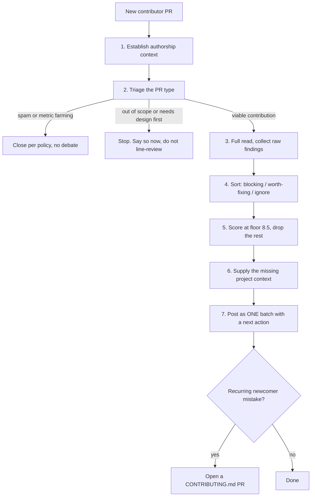

# Contributor Experience Review

A sequencing lens on top of [`pr-review`](https://github.com/priyank766/OpenSource-SKILL/blob/main/skills/pr-review/SKILL.md), for PRs from people who
have not contributed to this repo before.

**Read first:** [`DETECTION-PLAYBOOK.md`](references/DETECTION-PLAYBOOK.md) ·
[`QUALITY-FILTER.md`](references/QUALITY-FILTER.md) ·
[`REVIEW-VOICE.md`](references/REVIEW-VOICE.md)

> **Where the time goes.** Finding the flaw is the review. The playbook above is the
> general flaw-hunting procedure; this file is the domain-specific lens on top of it.
> Scoring and writing the comment are the last ten minutes, not the work.

**Severity floor: 8.5** — higher than the general floor of 8.0, not lower. A regular
contributor reads a 7.5/10 nit as a nit and ignores it. A newcomer cannot tell a blocking
issue from a preference, so every comment you post reads as a condition of merge, and a
review of twelve comments reads as a rejection. The floor goes up because the cost of noise
goes up. Cut harder, not softer.

---

## Governing rules

**The bar is the same.** Correctness, tests, scope, and API compatibility are judged
exactly as they would be for a core maintainer. Merging a weaker patch because the author
is new ships a bug to users, leaves the maintainer holding it, and teaches the contributor
that this project does not mean what it says. Only the *sequencing* changes.

**One round, not five.** A newcomer PR that takes four review round-trips usually loses the
contributor somewhere around trip three. Read the entire PR before writing anything.
Resolve every issue you intend to raise. Deliver it as one batch and say so in plain words:
"this is everything I found — nothing else is coming."

**Never leave them guessing what happens next.** Every review ends with one unambiguous
next action and a named owner: they push a fix, you push a fix, you merge on green, or you
close. A review that ends with observations and no instruction is an incomplete review.

**Unstated context is the actual defect.** Most newcomer PR problems are the project having
failed to write something down, not the person having failed to read it. If three people in
a row miss the changelog fragment, the changelog fragment is undocumented. Treat a recurring
newcomer mistake as a bug in `CONTRIBUTING.md` and fix it there.

---

## Why this exists

Projects lose contributors at a predictable point: the second round-trip on their first PR.
The usual cause is not hostility. It is a review that was technically fine and
operationally shapeless — nits mixed with blockers, no ordering, no statement of what
merging requires, delivered in three installments over five days.

The fix is not warmth. It is compression.

### What each role gets out of it

| Role | Time this gives back |
| :--- | :--- |
| **Maintainer** | Your real cost is round-trips, not comments. Each one is a context reload days later. Front-loading turns a five-touch PR into a two-touch PR, and triage-first stops you line-reviewing code that was never going to merge. |
| **Contributor** | One list, ordered, with the blocking items marked. You know what merging requires before you start, instead of discovering it one comment at a time. |
| **Project owner** | Retention. A contributor who lands a first PR cleanly often lands a fifth, and eventually reviews someone else's — the only durable fix for maintainer load. Each unnecessary round-trip is a measurable drop in that. |

---

## Procedure



### 1. Establish authorship context

```bash
gh pr view <PR> --json author,createdAt,isDraft,files
gh api /repos/<OWNER>/<REPO>/pulls/<PR> --jq .author_association   # not a gh --json field
gh search prs --author <USER> --repo <OWNER>/<REPO> --state all
gh search prs --author <USER> --state all --limit 30      # pattern across all projects
gh pr view <PR> --json body --jq .body                    # does it link an issue?
gh issue view <ISSUE> --json assignees,state,labels        # was it assigned to someone else?
```

An `author_association` of `FIRST_TIME_CONTRIBUTOR` or `NONE` is the trigger. It is only
available from the REST API — `gh pr view --json` does not expose it. A cross-project
search returning thirty single-line PRs opened in one hour is the strongest slop signal
available. An unassigned linked issue is fine; an issue assigned to someone else three weeks
ago is a conversation to have before reviewing a line.

### 2. Triage first: what kind of PR is this?

Do this before any line-level reading. The correct response differs completely by category,
and reviewing code in the wrong category is pure waste.

**(a) Genuine newcomer contribution, technically viable.** Signals: linked issue, a PR
description in their own words, tests touched, questions asked in the thread, scope matches
the issue. *Handling:* proceed to the batched review below. This is the main path.

**(b) Viable, but out of scope, duplicating existing work, or against the roadmap.**
Signals: reimplements something already in `main` or in an open PR, adds a dependency the
project has previously rejected, changes a public interface the roadmap is about to
replace. *Handling:* **stop.** Say so in the first response, link the existing PR or the
decision, and do not line-review. Reviewing code that will not merge in this form spends
your time and theirs and makes the eventual "no" look arbitrary.

**(c) Low-effort or AI-generated with no understanding behind it.** Signals: sweeping
rewrites across unrelated files, invented APIs that do not exist in the codebase, comments
restating each line, a PR description that summarizes the diff instead of the intent,
tests that assert nothing, no reply or an equally generated reply when asked a specific
design question. *Handling:* ask one specific question only they could answer — "what
happens to the retry path when `cfg.timeout` is nil here?" No substantive answer means
close it, with the project's policy cited. Do not review it into shape.

**(d) Spam or metric farming.** Signals: whitespace-only, README emoji or badge additions,
trailing-comma churn, `.gitignore` noise, dozens of identical PRs across repos during
October. *Handling:* close per the project's stated policy. Label `spam` or
`invalid` so it does not count toward Hacktoberfest. No debate — the policy is the reason.

**(e) A good idea that needs a design discussion before code.** Signals: a genuine problem
solved in a way that pins the project to an approach, new public surface, a new
configuration axis. *Handling:* **stop line-reviewing.** Say the idea is worth pursuing,
name the design question that has to be settled first, and move it to an issue or
discussion. Then say what happens to the PR meanwhile: usually "leave it open, I'll come
back once we've settled the interface."

> Rule: for (b) and (e), the review is the triage. Posting inline comments on code whose
> shape is not yet agreed is the most common way a newcomer PR burns two weeks.

### 3. Batch and sequence

Read everything first. Collect raw findings with no prose. Then sort into three piles:

- **Blocking** — merging causes a bug, a regression, a security issue, or breaks CI.
  Inline, at the exact line, with a patch they can apply. Ideally one to three of these.
- **Worth fixing, not blocking** — scores 8.5+, matters, but the PR is mergeable without
  it. In the summary body, explicitly marked optional.
- **Ignore** — everything else. Not "mentioned briefly", not "a few small things". Gone.
  Trivia you cannot let go of gets a single suggested-changes batch they can accept with
  one click, or you fix it yourself after merge.

State the count in the first line of the summary: "Two things block merge, one optional,
that's everything." A newcomer's first question is always *how much more of this is there*.
Answer it before they ask.

**CI and lint.** Never point at the red X. Point at the exact command that reproduces it
locally, and say whether it is theirs to fix or auto-fixable.

> `make lint` locally will flag the same two files CI did — `ruff format .` fixes both.

If the format check is auto-fixable and the project allows it, running it yourself is often
cheaper than a round-trip. Ask first: "want me to push the format fix, or would you rather
do it?" Pushing to someone's branch without asking is covered under anti-patterns.

### 4. Supply the context they are missing

Assume none of this is known. State the ones that apply, in one line each, in the summary —
not as fourteen separate threads.

- [ ] **How to run the tests here** — the exact command, including any setup step
      (`uv sync && uv run pytest -q`), not "run the tests".
- [ ] **DCO or CLA** — whether commits need `git commit -s`, and how to fix already-pushed
      commits: `git rebase --signoff HEAD~<N> && git push --force-with-lease`.
- [ ] **Commit and PR title conventions** — conventional commits, required prefixes,
      whether the PR title becomes the squash commit message.
- [ ] **Changelog fragments** — whether one is required and where it goes.
- [ ] **Rebase or merge** — which the project wants, and whether the maintainer squashes on
      merge anyway (in which case say "don't bother cleaning up the history").
- [ ] **Force-push** — whether it is acceptable mid-review. Many projects prefer fixup
      commits until approval so review threads stay anchored. Say which.
- [ ] **Generated files** — whether to commit generated code, lockfiles, or docs output,
      and the command that regenerates them.
- [ ] **Turnaround expectations** — "I look at PRs on weekends" prevents the anxious ping on
      day three.
- [ ] **Who can merge** — if your approval is not sufficient, say whose is and that you have
      asked them.

If you have explained any of these more than twice, it belongs in `CONTRIBUTING.md`.
Opening that documentation PR is a legitimate, expected output of this review — arguably a
higher-value one than the review itself, since it deletes the explanation permanently.

---

## Declining well

A slow no is worse than a fast no. Someone who is told in a day that their approach does
not fit loses an afternoon. Someone told after three weeks of review loses three weeks and
usually the project too.

Four parts: decide fast, give the real reason, credit the specific work, name a concrete
alternative. Skip any of these and it reads as a brush-off.

```markdown
Thanks for digging into this — the reproduction in the issue thread was the useful part,
and it's what let me confirm the bug is real.

I'm going to close this one though. We're moving `config/` to the schema-driven loader in
#412 next month, and this adds a second parsing path we'd have to remove again. Not a
problem with the patch — the timing is bad.

The same validation gap exists in `env.py` and won't be touched by #412. If you want it,
#389 is that work and it's unassigned. Happy to sketch the approach in the issue first so
you're not guessing.
```

Then close it. Do not leave a PR you have decided against sitting open for months — that is
a worse outcome than a decline, because it consumes the contributor's attention indefinitely
and pollutes your queue. If you genuinely cannot decide, say when you will, and put it in a
milestone.

---

## Scoring calibration

Inherits the [10-point filter](references/QUALITY-FILTER.md); floor raised to **8.5**.

| Finding | Score | Action |
| :--- | :---: | :--- |
| A real bug in the diff — nil deref, off-by-one, resource leak | 9.5 | Post inline with a patch. The bar does not move. |
| PR is out of scope or duplicates open work; stop and say so | 9.5 | Say it first, before any line comment. |
| Missing test for the branch the PR exists to fix | 9.0 | Blocking, with the test sketched. |
| Review ends with no unambiguous next action | 9.0 | Process defect in *your* review. Fix before posting. |
| Undocumented project requirement (DCO, changelog fragment) | 8.5 | State it once, with the command. Then fix the docs. |
| Naming or structure preference, no failure mode | 7.0 | Drop. |
| A nit posted inline to a first-time contributor | — | **Actively negative value.** Reject regardless of correctness. |
| Style the linter or formatter already enforces | — | Reject. Point at the command once, in the summary, or not at all. |

Comment budget: **one per ~300 changed lines, capped at 3 inline.** Tighter than
`pr-review`, deliberately.

---

## Anti-patterns

**The 14-nit review.** Technically all true, collectively a wall. The author reads it as
"this is not close" and stops. Three comments that block merge beat fourteen that are
correct.

**The drip-feed review.** Two comments Monday, three Wednesday, a new blocker Friday. Each
installment resets their sense of how far away merge is. Read it all, post it all, once.

**"Please read CONTRIBUTING.md."** They did, or it does not say what you think it says.
Quote the specific line and the specific command. If it genuinely is not in there, that is
your bug, not theirs.

**Silently taking over the branch.** Pushing your own commits to a contributor's fork
without asking removes their authorship from the work and reads as "you were too slow."
Ask. Most people say yes.

**Approving substandard code out of pity.** It ships a bug, it lands the maintenance on the
maintainer, and it tells the contributor the standard was never real. Say what is missing
and give them the chance to fix it.

**Letting it go stale.** No decision for two months is a decline delivered in the most
expensive possible way.

---

## Worked examples

### The batched review body

**AI baseline (6.2/10)** — fourteen separate inline threads, including three about naming,
two about missing docstrings, one about a trailing comma, plus:

> Thanks so much for your first contribution to the project! Great work overall. I've left
> some comments below. Also, the CI is failing — could you take a look? Please also make
> sure you've read our CONTRIBUTING.md.

**Maintainer-grade (9.5/10)** — one summary, two inline patches, nothing else:

> Ran this against the suite locally — the new test covers the case in #388 correctly.
>
> Two things block merge, one optional, and that's everything I found:
>
> - `loader.py:74` — `cfg.timeout` is nil on the retry path, so this panics on the second
>   attempt. Patch in the inline comment.
> - Commits need a sign-off (DCO check). `git rebase --signoff HEAD~2 && git push
>   --force-with-lease` fixes both.
> - Optional: the fixture could reuse `tmp_path` like `test_env.py` does. Ignore if you
>   like — I'll tidy it after merge otherwise.
>
> Lint is red on formatting only — `ruff format .` clears it. Once the sign-off lands and
> CI is green I'll merge; you don't need anything from anyone else.

### A dropped nit

**Raw observation:** the new helper is called `load_cfg` while the rest of the module uses
full words (`load_configuration`).

**Evaluation:** Correctness 10, Impact 4, Necessity 2, Empathy 5 for a first-time
contributor who will read it as a merge condition. **5.6/10.**

**Action: drop entirely.** Not in the summary, not as an aside. Rename it yourself in a
follow-up commit if it bothers you.

### The decline

**AI baseline (6.0/10)**

> Thank you for your contribution! Unfortunately, this doesn't align with our current
> project direction at this time. We appreciate your interest and hope you'll consider
> contributing again in the future. Closing.

**Maintainer-grade (9.5/10)** — see the template in *Declining well*: real reason
(#412 replaces this parsing path next month), specific credit (the reproduction), specific
alternative (#389, unassigned, offer to sketch it), closed the same day.

---

## Pre-post checklist

- [ ] Triaged the PR type before line-reviewing; (b), (d) and (e) never got a line review.
- [ ] Review ends with a single unambiguous next action and a named owner.
- [ ] `author_association` (via `gh api`) and prior-PR history checked; linked issue verified as unassigned.
- [ ] Entire PR read before the first word was written — no drip-feed.
- [ ] Findings sorted into blocking / optional / dropped, and the count stated up front.
- [ ] "That's everything I found" said explicitly.
- [ ] Every comment scored 8.5+; max 3 inline; zero nits.
- [ ] No comment duplicates what the linter, formatter, or CI already reports.
- [ ] CI and lint failures pointed at the exact local command, not the red X.
- [ ] Missing project context (tests, DCO, conventions, force-push, turnaround) stated once.
- [ ] Technical bar unchanged — nothing waved through because the author is new.
- [ ] Asked before pushing anything to their branch.
- [ ] If declining: decided fast, real reason given, effort credited, alternative named,
      PR closed rather than left open.
- [ ] Recurring newcomer mistake logged as a `CONTRIBUTING.md` fix.
