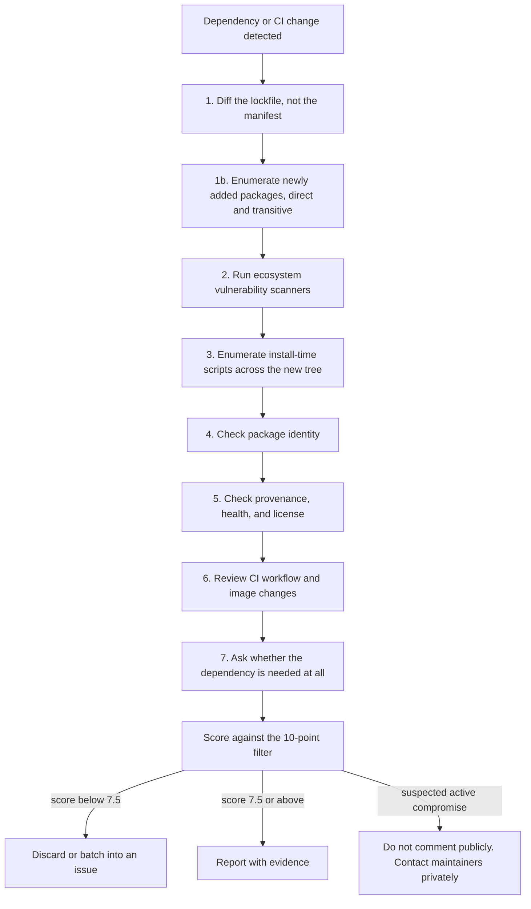

# Dependency & Supply-Chain Review

The lens for PRs where the risk is not in the diff's own code but in the code the diff
invites in. Layered on top of [`pr-review`](https://github.com/priyank766/OpenSource-SKILL/blob/main/skills/pr-review/SKILL.md).

**Read first:** [`DETECTION-PLAYBOOK.md`](references/DETECTION-PLAYBOOK.md) ·
[`QUALITY-FILTER.md`](references/QUALITY-FILTER.md) ·
[`REVIEW-VOICE.md`](references/REVIEW-VOICE.md)

> **Where the time goes.** Finding the flaw is the review. The playbook above is the
> general flaw-hunting procedure; this file is the domain-specific lens on top of it.
> Scoring and writing the comment are the last ten minutes, not the work.

**Severity floor: 7.5** — lower than the suite default of 8.0. A malicious or compromised
dependency executes with full build and runtime privilege on every contributor's laptop
and inside CI, where the tokens live. A false positive costs one thread of discussion. A
miss costs the project's release signing key. That asymmetry justifies the lower bar; it
does not justify posting health-score trivia.

---

## The governing rule

> Adding a dependency adds every one of that package's maintainers to your project's trust
> boundary — and every maintainer of every one of its transitive dependencies too.

So the review question is never "is this library good". It is:

**What does merging this let someone else execute, and where?**

"Where" has three answers, in descending order of severity: in CI with repository
credentials, on a contributor's machine at install time, and in production at runtime.
Score against the worst reachable one.

---

## Why this exists

Dependency PRs are the ones reviewers rubber-stamp. The manifest diff is one line, the
bot's changelog link looks fine, CI is green — and green CI is exactly what an
install-time payload produces. Meanwhile the actual review surface, the lockfile, is
collapsed by default in the GitHub UI as a generated file.

The default AI pass on these PRs is worse than useless: it summarises the changelog and
notes that the package is popular. That is a 5/10 comment on a diff with a 10/10 finding
three hundred lines down.

### What each role gets out of it

| Role | Time this gives back |
| :--- | :--- |
| **Maintainer** | The lockfile read you keep postponing, done as a checklist. You get "12 new transitive packages, one with a postinstall, here it is" instead of a 3,000-line generated diff you were going to scroll past. |
| **Contributor** | A pre-flight on your own dependency addition — wrong section, duplicate major version, copyleft license — so the first maintainer reply is not a request to remove it. |
| **Project owner** | A repeatable bar for what enters the trust boundary, and a blast-radius argument you can point at when justifying pinning, `--ignore-scripts`, or SHA-pinned actions. |

---

## Procedure



---

## 1. Read the lockfile diff, not the manifest

A one-line manifest change can pull forty transitive packages. The manifest states intent;
the lockfile states what actually gets installed. Only one of those is the trust boundary.

```bash
git diff base...head -- \
  package.json package-lock.json yarn.lock pnpm-lock.yaml npm-shrinkwrap.json \
  pyproject.toml uv.lock poetry.lock Pipfile.lock requirements*.txt \
  go.mod go.sum Cargo.toml Cargo.lock Gemfile Gemfile.lock composer.json composer.lock

git diff --stat base...head -- '*lock*' '*.sum'
```

Count what actually arrived. A "bump lodash" PR that adds 40 package entries is not a bump.

```bash
# npm / pnpm / yarn — new package entries in the lockfile
git diff base...head -- package-lock.json | grep -E '^\+\s+"node_modules/' | sort -u | wc -l
git diff base...head -- pnpm-lock.yaml    | grep -E '^\+\s{2}/' | sort -u

# Go — every added module line
git diff base...head -- go.sum | grep '^+' | awk '{print $1, $2}' | sort -u

# Cargo / Poetry / uv — added package stanzas
git diff base...head -- Cargo.lock  | grep -A2 '^\+name = '
git diff base...head -- poetry.lock uv.lock | grep -E '^\+name = '

# Python requirements
git diff base...head -- 'requirements*.txt' | grep -E '^\+[^-+]'
```

Then diff the resolved sets rather than the text, which removes reordering noise:

```bash
git show base:package-lock.json | jq -r '.packages | keys[]' | sort > /tmp/before.txt
jq -r '.packages | keys[]' package-lock.json | sort > /tmp/after.txt
comm -13 /tmp/before.txt /tmp/after.txt          # packages added by this PR
```

Three lockfile shapes deserve their own look, regardless of scanner output:

- **Manifest changed, lockfile not regenerated** (or the reverse). The installed tree no
  longer matches the declared one. `npm ci`, `uv lock --check`, `poetry check --lock`,
  `cargo update --locked`, and `go mod tidy -diff` all fail loudly on this — run one.
- **Lockfile entirely regenerated** in a PR whose stated purpose is a single bump. That
  hides every other change in the noise. Ask for it to be split.
- **An integrity hash changed with no version change.** Treated in §5; this is the single
  strongest signal in the file.

## 2. Run the ecosystem's scanners

Real tools only. Run whichever matches the lockfile that changed.

```bash
npm audit --omit=dev            # or: pnpm audit / yarn npm audit
npm audit signatures            # registry signature + provenance attestation check

osv-scanner --lockfile=package-lock.json
osv-scanner --lockfile=poetry.lock --lockfile=go.mod --lockfile=Cargo.lock
osv-scanner scan source -r .    # walks the tree for every lockfile it recognises

pip-audit -r requirements.txt   # or: pip-audit  (against the active env)
uv lock --check                 # lockfile is current w.r.t. pyproject.toml
uv pip compile requirements.in -o /tmp/out.txt && diff /tmp/out.txt requirements.txt

govulncheck ./...               # call-graph aware: reports only reachable vulns
go mod graph | grep '<pkg>'     # who pulls it in
go mod why -m <module>          # why it is in the build at all

cargo audit
cargo deny check                # advisories, licenses, bans, sources — in one pass

bundle exec bundler-audit check --update
composer audit
```

`govulncheck` is worth singling out: it reports reachability, not just presence. "CVE
exists in the tree" and "CVE is on a code path this project calls" are different findings
and score differently.

For the whole-image or whole-repo view, and for anything containerised:

```bash
syft . -o spdx-json > sbom.json
grype sbom:sbom.json --fail-on high
grype <image>:<tag>
trivy fs --scanners vuln,secret,license .
```

Data sources for the judgement calls, not the scanning:
[`deps.dev`](https://deps.dev) for transitive graphs and advisories per version, and
**OpenSSF Scorecard** for maintenance and release-integrity signals:

```bash
scorecard --repo=github.com/<owner>/<repo> --checks=Maintained,Signed-Releases,\
Dangerous-Workflow,Token-Permissions,Branch-Protection
```

In CI, GitHub's `actions/dependency-review-action` blocks the merge on new
vulnerable or license-violating dependencies. If the repo lacks it and takes frequent
dependency PRs, that is a legitimate suggestion for the summary — but it is
infrastructure advice, not a finding about this diff.

## 3. Install-time code execution — the highest-signal check

Runtime code has to be reached. Install-time code runs unconditionally, on every
contributor's machine and in CI, before any test asserts anything. Check this first on
every newly added package.

**npm / pnpm / yarn.** `preinstall`, `install`, `postinstall`, `prepare`, plus
`node-gyp-build` and any binary-downloading `install` step.

```bash
# every lifecycle script in the resolved tree, package by package
npm ls --all --json > /tmp/tree.json
find node_modules -name package.json -not -path '*/node_modules/*/node_modules/*' \
  -exec jq -r 'select(.scripts.preinstall or .scripts.install or .scripts.postinstall
                      or .scripts.prepare)
               | "\(.name)@\(.version): \(.scripts | {preinstall,install,postinstall,prepare}
                   | with_entries(select(.value)) )"' {} \; | sort -u

# pnpm: same idea — walk the installed tree and keep only packages with lifecycle scripts
pnpm ls --depth Infinity --json \
  | jq -r '.. | objects | select(.path) | .path' \
  | while read -r p; do
      jq -r 'select(.scripts.preinstall or .scripts.install or .scripts.postinstall
                    or .scripts.prepare) | "\(.name)@\(.version)"' "$p/package.json" 2>/dev/null
    done | sort -u
```

Then the differential test — the point is not that the install fails, it is what the
script *did*:

```bash
rm -rf node_modules && npm ci --ignore-scripts   # does the project work without them?
npm ci --foreground-scripts 2>&1 | tee /tmp/install.log
grep -nEi 'curl|wget|https?://|base64|eval|child_process|nc |/dev/tcp' /tmp/install.log
```

Read the script body itself. Obfuscation, network fetches, environment harvesting
(`process.env`, `~/.npmrc`, `~/.aws`, `GITHUB_TOKEN`), or writes outside the package
directory are each on their own a 9.5.

```bash
grep -rnE "process\.env|https?://|Buffer\.from\([^)]*base64|child_process|eval\(" \
  node_modules/<new-package>/ --include='*.js' --include='*.cjs' | head -50
```

**Python.** `setup.py` is arbitrary code executed at build time; PEP 517 backends
(`build-backend`, `setup_requires`, custom hooks) and `cffi`/native builds are the same
surface.

```bash
# Fetch the sdist WITHOUT running anything. `pip download --no-binary :all:` is not safe
# here: pip still invokes the PEP 517 metadata hook, i.e. it executes setup.py.
curl -s "https://pypi.org/pypi/<pkg>/json" \
  | jq -r '.urls[] | select(.packagetype=="sdist") | .url' \
  | xargs curl -sL -o /tmp/src.tar.gz
tar -tzf /tmp/src.tar.gz && mkdir -p /tmp/src && tar -xzf /tmp/src.tar.gz -C /tmp/src
grep -nE "os\.system|subprocess|urllib|requests|exec\(|eval\(|__import__" /tmp/src/*/setup.py
python -m pip install --only-binary :all: <pkg>              # avoids sdist build entirely
grep -A5 '\[build-system\]' pyproject.toml                   # which backend is trusted
```

**Go.** No install hooks by design — but `//go:generate` directives, `cgo` blocks, and
linker flags in the added module are still build-time execution surfaces.

```bash
grep -rn '//go:generate' $(go env GOMODCACHE)/<module>@<version>/ | head
grep -rn 'import "C"\|#cgo' $(go env GOMODCACHE)/<module>@<version>/ | head
GOFLAGS=-mod=readonly go build ./...
```

**Rust.** `build.rs` runs at compile time with full privilege.

```bash
find ~/.cargo/registry/src -maxdepth 3 -name build.rs -newer Cargo.lock
cargo tree -i <crate>                       # what pulls it in
grep -rn 'std::process\|reqwest\|include_bytes!' ~/.cargo/registry/src/*/<crate>-*/build.rs
```

**Ruby.** Native extensions run `extconf.rb` at install:

```bash
gem contents <gem> | grep extconf.rb
```

The generalisable rule: if a package needs to execute code before your code exists, either
that is inherent to what it does (a compiler binding, a native driver) or it is a
question. New package plus install script plus no obvious native need is the highest-value
finding this skill produces.

## 4. Package-identity red flags

A package is not what its name says it is — it is what the registry served, published by
whoever currently holds the credentials. Nine signals, with the commands to check each,
in [`PACKAGE-IDENTITY.md`](references/PACKAGE-IDENTITY.md): typosquats and scope
confusion, a version published hours ago, a maintainer or ownership change, a dead or
mismatched repository link, no git tag for the published version, dependency confusion
between a public and an internal registry, and a git dependency pinned to a mutable
branch rather than a commit SHA.

The two with the worst payoff-to-effort ratio for an attacker, so check them first:

```bash
npm view <pkg> time.created time.modified maintainers repository.url
grep -nE '"(resolved|version)": "(git\+|https?://)[^"]*#(main|master|HEAD)' package-lock.json
```

---

## 5. Provenance, health, and licensing

Three checks that share a question: is the thing you are installing the thing the source
repository says it is, maintained by someone still present, under a license the project
can accept? Full procedure and commands in
[`PROVENANCE-AND-LICENSING.md`](references/PROVENANCE-AND-LICENSING.md).

The short version:

```bash
npm audit signatures                   # registry provenance attestations
npx license-checker --production --summary
pip-licenses --format=markdown         # Python equivalent
go-licenses report ./... 2>/dev/null   # Go equivalent
```

Two findings that clear the floor on their own: an integrity hash that changed without a
version change, and a copyleft license (GPL/AGPL/SSPL) entering a permissively licensed
project. Flag the license question for the maintainer to decide — it is a legal call, not
a reviewer's verdict.

---

## 6. CI workflow and container changes are dependency changes

A workflow edit and a base-image bump both grant third-party code execution inside
your build, often with more privilege than a runtime dependency ever gets. The full
procedure — action pinning, `pull_request_target`, secret exposure to forks,
`permissions:` widening, self-hosted runners, `curl | bash` steps, and image digest
pinning — is in
[`CI-AND-CONTAINER-REVIEW.md`](references/CI-AND-CONTAINER-REVIEW.md).

The two checks worth running on every such diff:

```bash
# actions pinned to a mutable tag rather than a full commit SHA
grep -rnE 'uses: [^@]+@(v?[0-9]|main|master)' .github/workflows/

# the highest-risk trigger in GitHub Actions
grep -rn 'pull_request_target' .github/workflows/
```

---

## 7. Is the dependency needed at all?

The cheapest supply-chain fix is not merging it. Five checks — micro-package, capability
already in the tree, framework pulled in for one helper, dev-only package placed in
runtime dependencies, and duplicate major versions — with commands per ecosystem in
[`IS-IT-NEEDED.md`](references/IS-IT-NEEDED.md).

The wrong-section mistake is the most common real defect in dependency PRs and takes ten
seconds to check:

```bash
git diff base...head -- package.json | grep -A20 '"dependencies"'
grep -rn '<pkg>' src/ lib/ --include='*.[jt]s' | grep -v test   # imported outside tests?
```

---

## Scoring calibration

Applied on top of the [10-point filter](references/QUALITY-FILTER.md), floor 7.5.

| Finding | Score | Action |
| :--- | :---: | :--- |
| Typosquat or package-identity mismatch (repo link does not match artifact) | **10** | Post. Do not merge. |
| Install-time script in an unvetted newly added package | **9.5** | Post, quote the script body. |
| Known exploitable CVE on a runtime code path (`govulncheck` reachable) | **9.5** | Post with the advisory ID. |
| `pull_request_target` plus checkout of untrusted PR code | **9.5** | Post. Private disclosure if already merged. |
| Integrity hash changed with no version change | **9.5** | Private disclosure path — see "If you suspect active compromise" under [Reporting the finding](#reporting-the-finding). |
| Copyleft license entering a permissively licensed project | **9.0** | Post as a factual flag for maintainers. |
| Action or base image pinned to a mutable tag rather than a SHA/digest | **8.5** | Post, one comment covering all occurrences. |
| Large transitive footprint for a trivial helper | **8.0** | Post once, with the count and the stdlib alternative. |
| Dev-only package placed in runtime dependencies | **8.0** | Post, one-line patch. |
| CVE present in the tree but demonstrably unreachable | 7.0 | Batch to an issue. |
| "This package hasn't been updated in a year", no other signal | **< 6.0** | Reject silently. |

Health signals compound rather than stand alone. New package (5.0) plus install script
(9.5) plus published two hours ago (5.5) is not three comments — it is one 10/10 comment
that names all three.

---

## Reporting the finding

Voice rules are in [`REVIEW-VOICE.md`](references/REVIEW-VOICE.md) and apply unchanged.
Two things are specific to this domain.

**Lead with the artifact, not the adjective.** A supply-chain claim without evidence reads
as paranoia. Quote the lockfile lines, the script body, or the scanner output verbatim —
that is what converts the comment from opinion to observation.

**AI baseline (6.2/10)**
> This PR adds several new dependencies. It may be worth reviewing them for security
> issues, as supply-chain attacks are increasingly common. Consider running `npm audit`.

**Maintainer-grade (9.5/10)**
> `node-ipc-utils@1.0.2` (added transitively via `build-tools`, `package-lock.json:4821`)
> has a postinstall that fetches and runs a remote script:
> ```json
> "postinstall": "node -e \"require('https').get(process.env.NPM_CFG_URL||'https://…')\""
> ```
> It was published 3 hours ago and the `repository` field points at a repo with no tag for
> this version. `npm ci --ignore-scripts` builds and tests fine without it — could we pin
> `build-tools` to 2.4.1, which doesn't pull it in?

**A finding that should not be posted.** `chalk` was last released 14 months ago. No
advisory, no install script, stable API, widely used. Correctness 10, Impact 3, Necessity
2, Empathy 6 → **5.5/10.** Reject silently. "Unmaintained" without a concrete consequence
is the most common noise this skill has to suppress.

**If you suspect active compromise** — obfuscated install script, credential harvesting, an
integrity hash change with no version change — do not comment publicly. A public comment
tips off the attacker and can start a scramble before maintainers have a plan.

```
Subject: Possible supply-chain issue in PR #<N> — please review before merge

Not posting this on the PR. In #<N>, <pkg>@<version> (<lockfile>:<line>) has
<the specific observation>. Evidence: <script body / hash diff / scanner output>.
Reproduce: <exact command>. Happy to help verify or open a private advisory.
```

Route it through `SECURITY.md`, the repo's private vulnerability reporting, or a
maintainer's listed contact. Cross-reference
[`security-review`](https://github.com/priyank766/OpenSource-SKILL/blob/main/skills/security-review/SKILL.md) for disclosure handling and for any
finding about the project's own code rather than its dependencies.

---

## Pre-post checklist

- [ ] Read the **lockfile** diff, not just the manifest; counted newly added packages.
- [ ] Enumerated install-time scripts in every newly added package, direct and transitive.
- [ ] Manifest and lockfile are consistent (`npm ci` / `uv lock --check` / `go mod tidy -diff`).
- [ ] Ran the ecosystem scanner (`osv-scanner`, `npm audit`, `pip-audit`, `govulncheck`,
      `cargo audit`) and quoted its output rather than paraphrasing it.
- [ ] Checked package identity: name similarity, publish date, maintainers, repo link,
      matching git tag.
- [ ] Checked provenance/attestation and looked for an integrity hash change with no
      version change.
- [ ] Verified reachability before scoring a CVE as high.
- [ ] Workflow diff reviewed: SHA pinning, `pull_request_target`, `permissions:`, secrets
      on fork triggers, self-hosted runners, pipe-to-shell.
- [ ] Container base images pinned by digest; `USER` is not root.
- [ ] Asked whether the dependency is needed at all, and whether it is in the right section.
- [ ] Licenses of newly added transitive packages classified; stated as a flag, not a verdict.
- [ ] Every comment scored 7.5 or above; related signals merged into one finding.
- [ ] Suspected-malicious findings routed privately, not posted on the PR.
- [ ] Explicit user approval obtained before any `gh api` write.
