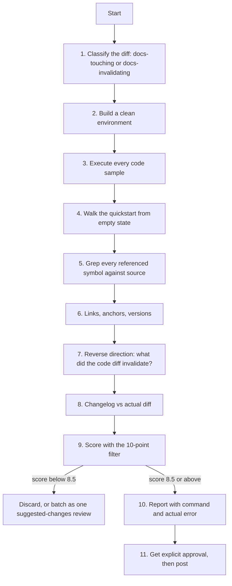

# Documentation Review

A specialised lens on [`pr-review`](https://github.com/priyank766/OpenSource-SKILL/blob/main/skills/pr-review/SKILL.md), for diffs that change documentation
and for diffs that break it without touching it.

**Read first:** [`DETECTION-PLAYBOOK.md`](references/DETECTION-PLAYBOOK.md) ·
[`QUALITY-FILTER.md`](references/QUALITY-FILTER.md) ·
[`REVIEW-VOICE.md`](references/REVIEW-VOICE.md)

> **Where the time goes.** Finding the flaw is the review. The playbook above is the
> general flaw-hunting procedure; this file is the domain-specific lens on top of it.
> Scoring and writing the comment are the last ten minutes, not the work.

**Severity floor: 8.5** — higher than the suite default of 8.0. Docs attract more low-value
opinion per line than any other part of a codebase: everyone can read prose, so everyone has a
view on it, and a review thread fills with comma placement while the broken `pip install` line
three paragraphs down goes unmentioned. Raising the floor is the only defence. At 8.5, a finding
ships only if it is a correctness error or something that stops a reader completing the task.

---

## The governing rule

**Documentation is code that is never executed, so it rots silently. The job is to execute it.**

Nothing in CI runs the README. No test fails when a tutorial's second command starts erroring.
The drift is invisible until a user hits it, and by then it has cost them an hour and cost the
project an issue. Wrong docs are worse than missing docs: a missing doc costs a search, a wrong
doc costs a debugging session against a description of software that no longer exists.

So the review is not a read. It is a run. Every fenced block gets executed, every command gets
typed from an empty directory, every symbol named in prose gets grepped for in the source. What
you cannot execute, you verify against the code. What you can neither execute nor verify, you do
not comment on.

Grammar is not the job.

---

## Why this exists

Docs PRs get either rubber-stamped or nitpicked, rarely reviewed. Both failure modes are
expensive. Rubber-stamping ships instructions nobody tried; nitpicking spends a maintainer's
evening on style and still ships instructions nobody tried.

### What each role gets out of it

| Role | Time this gives back |
| :--- | :--- |
| **Maintainer** | The verification you would have to do yourself, already done and pasted: the exact command, the exact error. No thread about hyphenation. A docs PR becomes a two-minute merge instead of a deferred tab. |
| **Contributor** | Your quickstart tested from a clean container before a maintainer discovers it fails on a machine without your `~/.config` already populated. |
| **Project owner** | Fewer "the README doesn't work" issues, which are the highest-volume and lowest-information class of report a project receives, and the one most likely to make a first-time user leave. |

---

## Procedure



---

## 1. Classify the diff

Two different reviews live here. Run whichever applies; run both when both apply.

```bash
git diff --name-only upstream/main...pr-<N>
```

Prose paths (`docs/`, `*.md`, `*.rst`, `*.mdx`, `site/`, docstrings) mean **forward direction**:
does what this PR now says match reality? Source paths only, with no docs touched, mean
**reverse direction**: what does this PR make untrue elsewhere? Section 7 covers that, and it is
the class of defect reviewers miss most.

---

## 2. Build a clean environment

Your machine is contaminated. It has the package installed, the credentials cached, the repo
already cloned, the tool on `PATH` from some other project. Every one of those hides a missing
prerequisite step.

```bash
# Throwaway container, repo mounted read-only (`:ro`) since you run untrusted README
# commands in here; build into /tmp inside the container if a step needs to write.
docker run --rm -it -v "$PWD":/w:ro -w /w python:3.12-slim bash
docker run --rm -it -v "$PWD":/w:ro -w /w node:22-slim bash
docker run --rm -it -v "$PWD":/w:ro -w /w rust:1-slim bash

# No container available: at minimum a fresh venv and a scratch HOME
python -m venv /tmp/docscheck && . /tmp/docscheck/bin/activate
env -i HOME=$(mktemp -d) PATH=/usr/bin:/bin bash --noprofile --norc
```

`env -i` is the cheap version of the whole exercise: it strips the environment variables that
your shell has been quietly supplying to every command in the tutorial.

---

## 3. Execute every code sample

### Extract the fenced blocks

```bash
# All fenced blocks with their language tag, numbered, from one file
awk '/^```/{f=!f; if(f){n++; lang=substr($0,4); print "--- block " n " (" lang ")"} next} f' README.md

# Write each python block to /tmp/blocks/NNN.py
python - <<'EOF'
import pathlib, re
src = pathlib.Path("README.md").read_text()
out = pathlib.Path("/tmp/blocks"); out.mkdir(exist_ok=True)
for i, m in enumerate(re.finditer(r"```(\w+)\n(.*?)```", src, re.S), 1):
    lang, body = m.group(1), m.group(2)
    out.joinpath(f"{i:03d}.{lang}").write_text(body)
    print(f"{i:03d}.{lang}  {len(body.splitlines())} lines")
EOF
```

### Run them, per ecosystem

```bash
# Python — docstrings and doctest-style blocks
python -m doctest -v docs/guide.md
pytest --doctest-modules src/
pytest --doctest-glob='*.md' docs/
pytest --codeblocks docs/            # pytest-codeblocks
pytest --markdown-docs docs/         # pytest-markdown-docs

# Rust
cargo test --doc
mdbook test docs/                    # if the book is mdBook

# Go — Example functions are compiled and their Output: comments asserted
go test ./...
go vet ./...

# TypeScript / JavaScript
npx tsx /tmp/blocks/004.ts
npx tsc --noEmit --strict /tmp/blocks/004.ts   # catches signatures that no longer typecheck

# Shell — the flags matter; without them a failing line scrolls past unnoticed
bash -euo pipefail /tmp/blocks/002.sh
shellcheck /tmp/blocks/*.sh
```

`--strict`/`-euo pipefail` are the point. A snippet that "works" because the failure was
swallowed is a snippet that fails for the reader who is watching.

### Compare output, not just exit status

A sample that runs is only half-verified. If the doc shows output — a printed value, a table, a
JSON body, a tree of files — diff the real output against the documented one.

```bash
python /tmp/blocks/003.py > /tmp/actual.txt
diff -u /tmp/documented.txt /tmp/actual.txt
```

Stale output blocks are common after a formatting change, a field rename, or a version bump in a
dependency that prints differently. They read as authoritative and are wrong.

---

## 4. Walk the quickstart from a truly empty state

Not "clean-ish". Empty. New directory, no clone, no config file, no cached token, no global
install, not logged in.

```bash
cd "$(mktemp -d)"
# Now execute the quickstart literally, line by line, copy-paste, in order.
```

What this catches, and nearly nothing else does:

- the `git clone` step that is missing because the author was already in the repo;
- `pip install -e .` documented but the build backend needs a newer `pip` than the base image;
- an auth step assumed because the author's token has lived in `~/.netrc` for two years;
- a database migration or `docker compose up` that is implied by "then run the server";
- a step ordering that only works if a previous tutorial was completed first.

If a step needs prior state, the doc must say so. "Assumes you completed the install guide" is a
legitimate fix and a one-line suggestion.

---

## 5. Every symbol named in prose must still exist

Prose references decay faster than code because no compiler checks them.

```bash
# Pull the code-span identifiers out of the docs and test each against the source
grep -rhoP '`[A-Za-z_][A-Za-z0-9_.]{2,}`' docs/ README.md \
  | tr -d '`' | sort -u > /tmp/symbols.txt

while read -r sym; do
  base="${sym##*.}"
  git grep -qn -- "$base" -- ':!docs' ':!*.md' || echo "MISSING IN SOURCE: $sym"
done < /tmp/symbols.txt
```

Then check the ones that *do* exist actually exist *publicly*, and with the documented shape:

```bash
python -c "import mypkg, inspect; print(inspect.signature(mypkg.connect))"
go doc ./pkg/client Connect
cargo doc --no-deps && grep -rn "pub fn connect" src/
```

Renames and module moves are the usual finding: the symbol resolves somewhere in the tree, but
the documented import path no longer reaches it.

---

## 6. Links, anchors, versions

```bash
lychee --no-progress README.md 'docs/**/*.md'
lychee --offline docs/            # relative paths and anchors only, no network
npx markdown-link-check README.md
```

Beyond dead external links, three cheaper-to-miss cases:

- **Relative paths broken by a move.** If the diff moves or renames a file, every relative link
  pointing at it, and every relative link inside it, is suspect: `git log --diff-filter=R
  --name-status -1` lists the renames, then `git grep -n "old/path"`.
- **Anchors.** `#configuration-options` breaks the moment the heading is reworded. Fragment
  checking is opt-in — `lychee --offline --include-fragments docs/`; a manual
  `git grep -n "](#"` finds the candidates.
- **Version drift.** Pinned versions in install instructions against what the project now
  requires:

```bash
git grep -nE '(python_requires|requires-python|"engines"|rust-version|^go [0-9])' \
  -- pyproject.toml setup.cfg package.json Cargo.toml go.mod
git grep -nE '(Python|Node|Go|Rust)\s*(>=|[0-9]+\.[0-9]+\+?)' -- '*.md' docs/
git grep -nE 'pip install [a-z0-9_-]+==|npm i(nstall)? [a-z0-9@/-]+@[0-9]' -- '*.md' docs/
```

A README claiming Python 3.8 support against `requires-python = ">=3.10"` is a 9.0 finding: it
sends users down an install path that cannot work.

---

## 7. The reverse direction — what did this code diff just invalidate?

**This is the single most-missed class of docs defect, and the highest-value thing in this file.**
The PR touches only `src/`. Nothing in the diff looks like documentation. Somewhere in `docs/`,
a tutorial now teaches a flag that no longer exists.

Build the list of changed surface, then grep the entire prose tree for each item.

```bash
# 1. What identifiers did this diff add or remove?
git diff -U0 upstream/main...pr-<N> -- src/ \
  | grep -E '^[+-]' | grep -vE '^(\+\+\+|---)' \
  | grep -oE '\b[A-Za-z_][A-Za-z0-9_]{3,}\b' \
  | sort | uniq -c | sort -rn | head -40

# 2. Changed CLI flags, config keys, env vars, defaults
git diff upstream/main...pr-<N> | grep -nE '^[+-].*(--[a-z][a-z0-9-]+|[A-Z_]{4,}=|default\s*=)'

# 3. Grep every candidate across every place prose lives
for sym in connect_timeout --retry-limit MYAPP_TOKEN; do
  echo "=== $sym"
  git grep -n -- "$sym" -- docs/ 'README*' 'CHANGELOG*' examples/ site/ content/ \
      '*.md' '*.mdx' '*.rst' '*.ipynb' '*.py' '*.go' '*.rs' '*.ts'
done
```

The last search deliberately includes source files: docstrings and inline example comments are
documentation too, and they live next to the code that just changed without being updated by it.

Three specific triggers that almost always leave stale docs behind:

- **A default value changed.** Every doc that states the old default is now wrong, and the wrong
  value reads as fact. `git grep -n "defaults to"` and `git grep -n "by default"` across `docs/`.
- **An argument became required, or the order changed.** Every positional-call example breaks.
- **A config key was renamed.** Users copy config from docs verbatim; a stale key usually fails
  silently by being ignored rather than loudly by erroring.

If the PR changed one of these and touched no docs, that is the finding. State the grep, list
the hits with file and line, and suggest the edit.

---

## 8. Changelog against what the diff actually did

```bash
git diff upstream/main...pr-<N> -- CHANGELOG.md docs/changelog* .changes/
git diff --stat upstream/main...pr-<N>
```

Check three things: an entry exists if the project requires one (`CONTRIBUTING.md` says); it is
under the right heading (a behaviour change filed under "Fixed" hides a break); and it describes
the diff rather than the intent. A changelog entry announcing a flag the diff renamed but did not
implement is a real finding.

---

## Defect catalogue

| Defect | How to detect it | Why it hurts |
| :--- | :--- | :--- |
| **Sample does not run** | Extract and execute in the clean container | The reader's first interaction with the project is an error. Highest-attrition defect there is. |
| **Runs, but output differs from what is shown** | `diff -u` real stdout against the documented block | The reader assumes they broke something and starts debugging working software. |
| **Missing prerequisite** (install, auth, migration) | Quickstart from `mktemp -d` with `env -i` | Fails only for new users — that is, exactly the audience the doc exists for. |
| **Implied-but-absent state** ("run the server") | Same walk; note every command that needs something already running | Reader gets a connection refused with no clue it was expected. |
| **Wrong argument order / renamed parameter** | `inspect.signature`, `go doc`, header grep vs the sample | Silently wrong results when types coincide; confusing errors when they don't. |
| **Stale default value** | `git grep -n "defaults to\|by default"` vs the source default | Reader configures around a default that isn't there, or omits a setting they needed. |
| **Author's OS or shell only** | Look for `brew`, `apt`, backslash paths, `%VAR%`, `export`, `source`, `readlink -f`, GNU-only `sed -i` | Half the audience is blocked on line 2 with no workaround stated. |
| **Documents intended, not shipped, behaviour** | Grep the feature name in source; run it | Users file bugs against a feature that was never merged; maintainers burn time triaging. |
| **Copy-paste block contains prompts or unmarked placeholders** | Look for leading `$`, `>`, `PS>`, or inline `path/to/your/thing` | Pasting the block runs `$: command not found`, or worse, half of it succeeds. |
| **Unmarked required placeholder** (`<YOUR_TOKEN>`) | Grep `<[A-Z_]{3,}>`; check the surrounding prose names it | Reader runs it literally and gets an auth error they can't attribute. |
| **Secrets, real tokens, internal hostnames in examples** | The secret-scan grep [below](#secret-scan-grep); grep internal domains and RFC1918 IPs | Live credential exposure and internal-topology leak. Escalate to [`security-review`](https://github.com/priyank766/OpenSource-SKILL/blob/main/skills/security-review/SKILL.md) and do not paste the value into a public comment. |
| **Dead link or broken anchor** | `lychee`, `lychee --offline --include-fragments`, `git grep -n "](#"` | On an install or security page it is a blocker; elsewhere often below the floor. |
| **Duplicated docs that now disagree** | `git grep -n "<phrase from the changed doc>"` — the same instructions usually exist in README *and* `docs/` | Two authoritative answers means the reader picks the wrong one 50% of the time. |
| **Generated API reference built from stale sources** | Check whether `docs/api/` is generated (`sphinx`, `typedoc`, `godoc`, `rustdoc`); if generated files are committed, regenerate and diff | Hand-edits to generated files vanish on the next build; stale generated files contradict the source. |
| **Docs added for a feature the PR does not implement** | For each new doc claim, find the implementing code; run it | Documentation-driven vapourware. The doc will outlive the intention. |

### Secret-scan grep

```bash
git grep -nE '(sk-|ghp_|AKIA)[A-Za-z0-9]{8,}'
```

(In ERE, `\|` is a *literal* pipe, so the alternation must be written unescaped — which is
why this lives in a code block rather than a table cell.)

---

## Out of scope — do not comment on these

- Grammar, spelling, and typos in prose. The single exception: a typo inside a command,
  config key, or identifier that must be typed verbatim — that is a broken sample, not a typo.
- Oxford commas, serial-comma consistency, hyphenation, capitalisation of headings, sentence
  case vs title case.
- "Consider adding more examples", "this section could be expanded", "a diagram would help".
  Unactionable scope expansion dressed as feedback.
- Tone, voice, formality, first person vs second person, whether it should say "simply".
- Anything Vale, `codespell`, `markdownlint`, or a link checker already runs in CI. Check
  `.github/workflows/` before writing a single style comment.

If you found nine typos, that is not nine comments. It is one GitHub *suggested changes* review
posted as a single batch, or — if the PR is about something else entirely — a separate PR of your
own. Nine inline threads for nine typos buries the one comment that mattered and teaches the
author to skim your reviews.

---

## Scoring calibration

| Finding | Score | Action |
| :--- | :---: | :--- |
| Documented sample errors out when executed | **9.5** | Post, with the command and the error text |
| Quickstart cannot be completed as written from a clean state | **9.5** | Post, naming the exact step that blocks |
| Code change silently invalidated an existing doc elsewhere in the repo | **9.0** | Post, with the `git grep` hits |
| Wrong default value or wrong argument documented | **9.0** | Post, with a suggestion block |
| Secret or real token in an example | **9.5** | Escalate privately; do not quote the value |
| Sample runs but printed output no longer matches | **8.5** | Post if the reader would act on the output |
| Dead link on an install, security, or contributing path | **8.5** | Post |
| Dead link in a peripheral "further reading" list | **7.0** | Batch, do not post inline |
| Duplicated docs that mildly disagree in wording | **7.0** | Batch |
| Typo, grammar, comma, heading case | **< 6.0** | Reject |

---

## Reporting the finding

Lead with evidence, not judgement. Paste the command you ran and the output you got, then the
fix as a GitHub `suggestion` block so the author can commit it from the web UI. Two to five
lines. Everything else about tone lives in
[`REVIEW-VOICE.md`](references/REVIEW-VOICE.md).

    Ran this in `python:3.12-slim` with an empty HOME:

    ```
    $ python -m mypkg serve --retry-limit 3
    error: unrecognized arguments: --retry-limit
    ```

    Looks like #412 renamed it to `--max-retries`:

    ```suggestion
    python -m mypkg serve --max-retries 3
    ```

### Before / after

**AI baseline (6.5/10)**
> The documentation in this section could be improved for clarity. It might be helpful to
> ensure the installation instructions are up to date and consider adding more detail about
> the prerequisites for new users.

**Maintainer-grade (9.5/10)**
> From an empty dir this fails at step 2 — `pip install -e .` needs the repo cloned first, and
> the clone step is only in the Contributing guide:
> ```suggestion
> git clone https://github.com/acme/mypkg && cd mypkg
> pip install -e .
> ```

**AI baseline (5.5/10) — a nit that should not exist**
> Typo: "recieve" should be "receive" on line 42. Also missing an Oxford comma on line 47, and
> the heading "Getting started" is inconsistent with "Advanced Usage" elsewhere.

**Maintainer-grade:** dropped. `codespell` runs in CI on this repo and will catch the first one;
the other two are preferences. If the typos were extensive, one batched suggested-changes review
instead — never a thread each.

---

## Pre-post checklist

- [ ] Ran every code sample in a clean environment (container, fresh venv, or `env -i`).
- [ ] Grepped `docs/`, `README*`, `examples/`, and docstrings for every symbol, flag, config
      key, or default the diff renamed or changed.
- [ ] Walked the quickstart start to finish from `mktemp -d` with no cached credentials.
- [ ] Compared documented output blocks against actual output, not just exit status.
- [ ] Verified every prose-referenced symbol still exists at the documented import path.
- [ ] Link check run, including `--offline` for anchors and relative paths.
- [ ] Pinned versions in docs checked against the project's declared minimums.
- [ ] Changelog entry present, correctly categorised, and matching what the diff did.
- [ ] Checked `.github/workflows/` — nothing posted that a CI linter already reports.
- [ ] Every comment scored 8.5 or above; typos batched into one suggested-changes review or
      dropped entirely.
- [ ] Each finding carries the command run and the actual error, plus a `suggestion` block.
- [ ] Explicit user approval obtained before posting anything.
