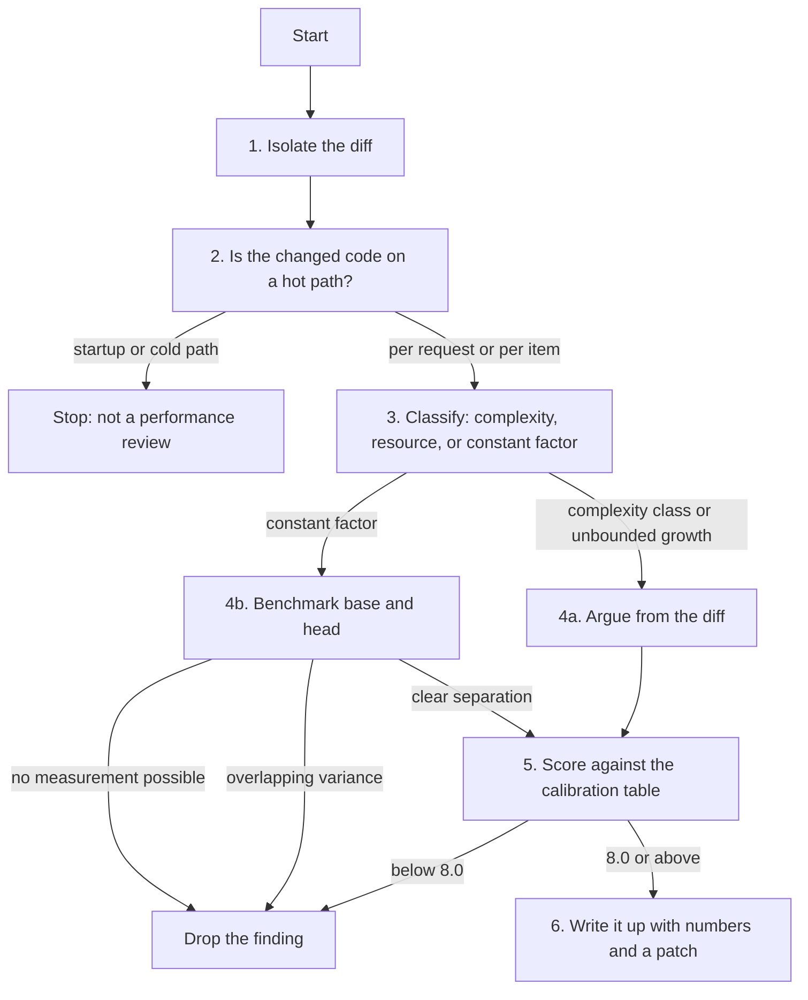

# Performance Review

A specialised lens on top of [`pr-review`](https://github.com/priyank766/OpenSource-SKILL/blob/main/skills/pr-review/SKILL.md). Run that procedure
first; this one replaces the line-by-line audit with a measurement discipline.

**Read first:** [`DETECTION-PLAYBOOK.md`](references/DETECTION-PLAYBOOK.md) ·
[`QUALITY-FILTER.md`](references/QUALITY-FILTER.md) ·
[`REVIEW-VOICE.md`](references/REVIEW-VOICE.md)

> **Where the time goes.** Finding the flaw is the review. The playbook above is the
> general flaw-hunting procedure; this file is the domain-specific lens on top of it.
> Scoring and writing the comment are the last ten minutes, not the work.

**Severity floor: 8.0.** Comment budget: one per ~200 changed lines, max 5.

---

## The governing rule: no measurement, no comment

An unmeasured performance suggestion cannot score above 6.0, because you cannot claim
Correctness on a number you did not produce. Under the shared filter that is a silent
reject. This is not a stylistic preference — it is the spine of the whole skill.

| Claim | Evidence required | Without it |
| :--- | :--- | :--- |
| "This is slow" | base vs head timing, n runs, variance | reject |
| "This allocates too much" | peak RSS or heap profile, both sides | reject |
| "This would be faster as X" | X implemented and benchmarked | reject |
| "This is O(n²) on a hot path" | the loop nesting in the diff + a call-graph path | **arguable** |
| "This cache/list grows without bound" | no eviction, no cap, unbounded key space | **arguable** |

Two exceptions, and only two. **Complexity-class regressions** are arguable from the diff
because the failure mode is structural: it does not matter what the constant factor is,
the curve crosses. **Unbounded resource growth** is arguable because there is no input
size at which it stops. Everything else — every constant-factor claim, every "this could
be faster" — is a hypothesis until you have run it twice.

The corollary matters as much: if you *did* measure and the win is under ~10% with
overlapping variance, you also have nothing. Report it as "no measurable difference" and
drop the comment.

---

## Why this exists

Performance is where AI review is at its worst. The pattern-match is easy (`for` loop
plus a function call), the confidence is high, and the cost lands on the maintainer, who
must either relitigate an unmeasured suggestion or look unresponsive. A project that has
absorbed twenty "consider using a list comprehension here" comments stops reading
performance feedback entirely — including the N+1 that matters.

### What each role gets out of it

| Role | Time this gives back |
| :--- | :--- |
| **Maintainer** | You stop relitigating unmeasured micro-opt. Anything that reaches you carries base/head numbers, so the discussion is about the trade-off, not about whether an effect exists. |
| **Contributor** | You find out your change regressed a hot path before a maintainer does, and you arrive with the benchmark already run — which is usually what unblocks the merge. |
| **Project owner** | A written standard for what counts as a performance claim in this repo, so "make it faster" PRs come with evidence by default. |

---

## Procedure



### 1. Isolate the diff

```bash
git fetch upstream 'refs/pull/<PR>/head:pr-<PR>'
git diff upstream/main...pr-<PR> --stat
git diff upstream/main...pr-<PR> -- '*.sql' '*.py' '*.go' '*.ts' '*.rs'
```

Note the base SHA. You will need to check it out and run the same benchmark on it.

```bash
git merge-base upstream/main pr-<PR>
```

### 2. Establish whether the code is hot at all

This step kills most candidate findings, and it should. Startup code that runs once,
CLI argument parsing, migration scripts, and test helpers are not performance surface no
matter what the loop looks like.

```bash
# who calls the changed function, and from where
grep -rn "process_batch" --include='*.py' . | grep -v test

# does it sit under a request handler / job loop / event handler?
grep -rn -B3 "process_batch(" src/ | grep -E "route|handler|@app|consume|for .* in "

# is it import-time work? (module level, decorators, class bodies)
git diff upstream/main...pr-<PR> | grep -E '^\+[^ \t]' | grep -v '^\+\(def\|class\|import\|from\|#\)'
```

If the path is cold, stop. If you cannot establish that it is hot, say so in the comment
and downgrade the claim — "if `process_batch` runs per request this matters; if it's only
the nightly job, ignore me."

### 3. Classify the finding

- **Complexity class** — nesting, membership tests, repeated scans. Arguable from the diff.
- **Resource growth** — caches, buffers, accumulating collections, listeners. Arguable.
- **Constant factor** — everything else. Requires measurement.

### 4. Measure — base and head, both, always

Run each side at least 5 times, on an otherwise idle machine, and report the spread.
A single run of each is not a measurement; it is a coin flip with extra steps.

**Python**

```bash
python -X importtime -c 'import mypkg' 2>&1 | sort -k2 -n -r | head -20   # import cost
python -m cProfile -s cumtime -m mypkg.cli run | head -40
pytest bench/ --benchmark-only --benchmark-json=head.json                 # pytest-benchmark
pytest-benchmark compare base.json head.json              # side-by-side, base vs head
python -m memray run -o head.bin script.py && python -m memray flamegraph head.bin
py-spy record -o profile.svg -- python script.py                          # no code changes
py-spy top --pid <PID>                                                    # live process
```

`tracemalloc.start(); ...; tracemalloc.get_traced_memory()` is the zero-dependency option
for allocation deltas inside a test.

**Node / TypeScript**

```bash
node --cpu-prof --cpu-prof-dir=./prof dist/bench.js     # .cpuprofile, open in DevTools
node --heap-prof --heap-prof-dir=./prof dist/bench.js
node --prof dist/bench.js && node --prof-process isolate-*.log | head -40
npx clinic doctor -- node server.js                     # event-loop delay, GC pressure
npx clinic flame -- node server.js
node bench/parse.bench.js                               # tinybench or benchmark.js harness
```

`tinybench` reports ops/sec with a margin of error; quote both. For event-loop blocking,
`clinic doctor`'s event-loop-delay chart is the artifact to cite.

**Go**

```bash
go test -run '^$' -bench 'BenchmarkParse' -benchmem -count=10 ./... > head.txt
git checkout "$(git merge-base upstream/main HEAD)"   # true baseline, not `git stash`
go test -run '^$' -bench 'BenchmarkParse' -benchmem -count=10 ./... > base.txt
git checkout -                                        # back to the PR head
benchstat base.txt head.txt          # go install golang.org/x/perf/cmd/benchstat@latest

go test -bench . -cpuprofile cpu.out -memprofile mem.out ./pkg/parser
go tool pprof -top -nodecount=20 cpu.out
go tool pprof -http=:8080 mem.out
```

`benchstat` is the reference for this whole skill: it prints the delta *and* a p-value,
and refuses to claim a difference when the samples overlap. Quote its output verbatim.

**Rust**

```bash
cargo bench                                     # criterion writes target/criterion/
cargo bench -- --save-baseline base
cargo bench -- --baseline base                  # after checking out head
cargo flamegraph --bench parse                  # cargo install flamegraph
```

**Ecosystem-agnostic**

```bash
hyperfine --warmup 3 --runs 20 './base/cli parse big.json' './head/cli parse big.json'
hyperfine --warmup 3 --export-markdown bench.md '<cmd>'    # paste-ready table
/usr/bin/time -v ./head/cli parse big.json 2>&1 | grep -E 'Maximum resident|Elapsed'
```

`hyperfine` gives mean ± σ and a relative factor across both binaries in one invocation,
which is exactly the shape a review comment needs.

### 5. Score, then write

Apply the calibration table below before writing prose. Then frame per
[`REVIEW-VOICE.md`](references/REVIEW-VOICE.md): claim → numbers → minimal patch →
one-line why.

---

## Pathology catalogue

### I/O and query patterns

**N+1 queries / I/O in a loop.** *Spot:* a `for` whose body calls a repository method,
an HTTP client, `os.stat`, or a template render. *Fails as:* latency scales with result
count; fine on 10 rows in dev, 30s on 10k in production. *Fix:* hoist the call, batch the
keys, use the ORM's eager-load (`selectinload`, `Include`, `Preload`, `JOIN`).

**Unbounded result sets.** *Spot:* a new `SELECT` or `find()` with no `LIMIT`, no
pagination, no cursor; `.all()` on a growing table. *Fails as:* works until the table
does not fit in memory, then OOM-kills the worker. *Fix:* keyset pagination, or stream
with a server-side cursor.

**Missing index implied by a new predicate.** *Spot:* a `WHERE`/`ORDER BY` on a column
with no index in the migration history. *Fails as:* full scan that grows linearly with
the table while the test fixture stays at 50 rows. *Fix:* ask for the `EXPLAIN` —
`EXPLAIN (ANALYZE, BUFFERS) <query>` in Postgres, `EXPLAIN ANALYZE` in MySQL 8 — and an
index migration if it reports `Seq Scan`.

**Chatty network calls.** *Spot:* sequential `await` per item against the same service.
*Fails as:* n × RTT, dominated by latency, not work. *Fix:* a batch endpoint, or bounded
concurrency (`asyncio.gather` over chunks, `errgroup` with `SetLimit`, `p-limit`).

**Excessive serialization round-trips.** *Spot:* parse → object → re-serialize → parse
again inside one request; `json.loads(json.dumps(x))` as a deep copy; a model rebuilt per
loop iteration. *Fix:* pass the parsed form through, or copy structurally.

### Memory and allocation

**Whole-file / whole-response buffering.** *Spot:* `f.read()`, `resp.content`,
`io.ReadAll`, `readFileSync` on anything user-sized. *Fails as:* peak RSS tracks the
largest input a user can supply — a DoS vector as well as a cost. *Fix:* stream —
`iter_content`/chunked reads, `io.Copy`, `stream.pipeline`, `BufReader::lines`.

**Unbounded caches and leaks.** *Spot:* a module-level `dict`/`Map` written but never
evicted; an event listener or subscription added with no matching removal; a slice
appended to on every request. *Fails as:* RSS grows monotonically until the process is
killed; usually invisible in CI. *Fix:* bounded LRU with an explicit max
(`functools.lru_cache(maxsize=...)`, `lru-cache`, `hashicorp/golang-lru`), a TTL, or
tying lifetime to the request scope.

### Algorithmic

**Accidental O(n²).** *Spot:* nested loops over the same collection; `x in some_list`
inside a loop; `result += s` string building; `list.index()` in a loop; repeated
`.filter()` over a growing array. *Fails as:* imperceptible at n=100, unusable at
n=100k. *Fix:* a `set`/`dict` for membership, `"".join(parts)` / `strings.Builder` /
array-join for concatenation, one pass building an index.

**Repeated recomputation.** *Spot:* a pure call with loop-invariant arguments inside the
loop; `re.compile` per call; a config parse per request; `len()` on a generator forcing
a walk. *Fix:* hoist above the loop, or memoize with a bounded cache.

### Concurrency

**Blocking I/O on an event loop.** *Spot:* `requests.get`, `time.sleep`, `open().read()`,
`fs.readFileSync`, a CPU-bound comprehension inside an `async def` or a Node handler.
*Fails as:* the loop stalls, so *every* concurrent request tail-latencies, not just this
one. *Fix:* the async client, or `asyncio.to_thread` / `run_in_executor` /
`worker_threads`. Detect it: `PYTHONASYNCIODEBUG=1`, or `clinic doctor`'s event-loop
delay.

**Premature parallelism and pool exhaustion.** *Spot:* a new thread pool, `gather` over
an unbounded list, or a per-call DB connection. *Fails as:* the work was I/O-bound on one
downstream anyway, and now you hold N connections; under load the pool starves and
latency goes up, not down. *Fix:* bound the concurrency and size it against the
downstream pool, or leave it sequential and say so.

### Startup

**Cold-start and import-time cost.** *Spot:* a new top-level import of a heavy library
(`pandas`, `torch`, an SDK), work in a module body or decorator, a client constructed at
import. *Fails as:* CLI startup and serverless cold starts regress for everyone,
including users who never touch the feature. *Fix:* import inside the function, or lazy
attribute access. Measure with `python -X importtime` or `node --cpu-prof` over a
no-op run.

---

## Cache correctness

Most cache findings are correctness findings, and they score higher for it. A cache that
is merely slow is a 7; a cache that returns another user's data is a 9.5.

**Invalidation.** Every write path that touches the cached entity must invalidate or
update it. Read the diff's write paths, not its read paths — the bug is always the write
that was missed.

**Key collisions and missing dimensions.** A key built from `user_id` alone when the
value also depends on locale, tenant, or feature flag will serve the wrong variant. Check
that every input to the computation appears in the key.

**Per-user data in a global.** A module-level cache or an `lru_cache` on a method whose
result depends on request context (auth, tenant, locale) leaks across users. This is a
security finding as much as a performance one — cross-reference
[`security-review`](https://github.com/priyank766/OpenSource-SKILL/blob/main/skills/security-review/SKILL.md).

**Caching failures.** A cached `None`, empty list, or timeout result turns a transient
error into a persistent one for the whole TTL. Cache successes; retry failures.

**Unbounded growth.** Covered above, but worth restating: an unbounded cache is a leak
with a friendly name.

---

## Scoring calibration

| Finding | Score | Post? |
| :--- | :---: | :--- |
| Complexity-class regression on a hot path (O(n) → O(n²)) | **9.5** | Yes, inline, with patch |
| N+1 query in a request path | **9.0 – 9.5** | Yes |
| Cache serving cross-user or stale-after-write data | **9.5** | Yes |
| Unbounded memory growth (cache, buffer, listener) | **9.0** | Yes |
| Whole-file read of user-supplied input | **8.5 – 9.0** | Yes |
| Blocking I/O inside async on a request path | **9.0** | Yes |
| Measured 2x+ win on a documented hot path, patch included | **8.5** | Yes |
| Measured 10–30% win, variance clean, cold-ish path | **7.0 – 7.5** | Follow-up issue |
| Measured win under 10% or variance overlaps | **< 6.0** | Reject |
| "This could be faster" with no measurement | **< 6.0** | Reject |

### Worked rejection

**Raw observation:** `build_report` uses a list comprehension where a generator would
avoid materializing the intermediate list.

**Evaluation:** Correctness 7 — true in principle, but the list is the function's return
value and the caller indexes it, so the generator would have to be materialized anyway.
Impact 2 — one function, no class of bug prevented. Necessity 2 — nothing is broken; no
timing or allocation numbers on either side. Empathy 5 — cheap to apply, but it starts a
thread about a change with no demonstrated effect.
**Score 4.1 → reject silently.** Not a summary aside, not a "minor note". Nothing.

---

## Comment examples

### N+1 in a request handler

**AI baseline (6.5/10)**
> This loop performs a database query on each iteration which may cause performance
> issues. Consider optimizing this for better performance.

**Maintainer-grade (9.5/10)**
> `order.customer` lazy-loads inside the loop, so this is one query per order — with the
> 500-order page in `test_large_account` it's 501 queries and 2.4s. `selectinload` brings
> it to 2 queries:
> ```python
> orders = session.scalars(
>     select(Order).where(Order.account_id == acct).options(selectinload(Order.customer))
> ).all()
> ```
> Measured on this branch, 5 runs: **2.41s ± 0.06 → 0.19s ± 0.01**. Same pattern is at
> `reports.py:214`.

### A regression found by benchmarking

**AI baseline (6.0/10)**
> The new validation step might slow down parsing. It would be good to benchmark this.

**Maintainer-grade (9.0/10)**
> The per-field `re.compile` in `_validate` costs about 3x on the parse path —
> `benchstat`, `-count=10`, base vs this branch:
> ```
>         │  base.txt   │              head.txt               │
>         │   sec/op    │    sec/op     vs base                │
> Parse-8   412.0µ ± 2%   1310.0µ ± 3%  +217.96% (p=0.000 n=10)
>
>         │  base.txt   │              head.txt               │
>         │    B/op     │     B/op      vs base                │
> Parse-8   18.40Ki ± 0%  209.0Ki ± 1%  +1035.87% (p=0.000 n=10)
> ```
> Hoisting the patterns to package-level `var` gets it back to 430µs ± 2%. Worth doing
> before this lands, since `Parse` is in the hot path for every ingest request. WDYT?

### A suggestion that gets dropped

**Raw observation:** the new `for` loop in `format_summary` calls `str.strip()` on every
line; a single regex pass would avoid the per-line call.

**What happened when it was checked:** `format_summary` runs once per CLI invocation on
at most a few hundred lines. `hyperfine --warmup 3 --runs 20` over both binaries:
**14.2ms ± 0.9 vs 14.0ms ± 1.1** — intervals overlap, no effect.

**Action:** drop it. Do not post "no measurable difference, but it's cleaner" either —
that is a style comment wearing a performance costume, and it should be scored as one.

### Reporting format

Inside a comment, a benchmark needs four things and nothing else: **what was run, base
number, head number, n and spread.**

> `hyperfine --warmup 3 --runs 20`, base `a1b2c3d` vs head: **1.82s ± 0.04 → 0.71s ± 0.03**
> (2.6x). Machine: 8-core CI runner, otherwise idle.

Absolute numbers first. "40% faster" with no baseline is unfalsifiable, and a percentage
on a 3ms operation is noise dressed as a result.

---

## When performance is not the priority

Plenty of projects rank readability above speed, and are right to. Before commenting,
check whether the repo has already made that call: a `CONTRIBUTING.md` line about clarity
over cleverness, a history of rejecting optimization PRs, or a comment in the file saying
the simple version is deliberate.

Do not raise performance on: setup and teardown code, one-shot migrations, test helpers,
`__repr__`, error-formatting paths, and anything that runs once per process. The
constant factor is real and irrelevant.

If a maintainer says a path is not hot, that settles it. They have the production
profile and you do not. "Ah — didn't realise that's only the nightly job, ignore me" and
resolve the thread. Re-arguing costs more maintainer time than the optimization would
ever return.

The exception, again narrow: unbounded growth on a cold path is still a bug, because
"cold" describes frequency, not lifetime. A leak in a once-per-request handler and a leak
in a once-per-hour job both end at the same OOM.

---

## Pre-post checklist

- [ ] The changed code is established as on a hot path — caller traced, not assumed.
- [ ] Every constant-factor claim is backed by a benchmark; unmeasured ones dropped.
- [ ] Benchmarked **both base and head**, same machine, same input, otherwise idle.
- [ ] At least 5 runs per side; variance or p-value reported, not just the mean.
- [ ] Reported **absolute numbers**, not percentages alone.
- [ ] Complexity and unbounded-growth claims name the input dimension that grows.
- [ ] Cache findings checked for invalidation, key completeness, and per-user leakage.
- [ ] Proposed patch applied locally and re-benchmarked, not just described.
- [ ] Maintainer's stated position on hotness respected; no re-arguing.
- [ ] Every comment scored 8.0 or above against the calibration table.
- [ ] Voice checked: no cheerleading, no robotic register, patch included, rationale given.
- [ ] Explicit user approval obtained before any `gh api` write.
