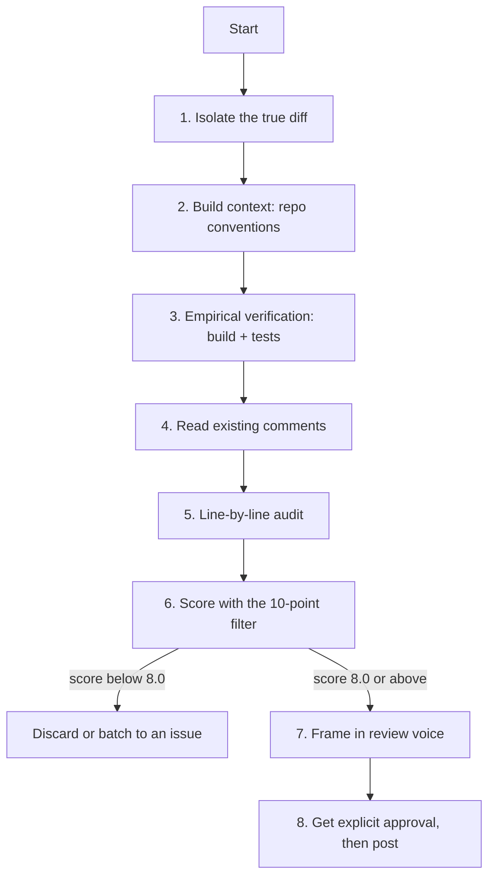

# Open Source PR Review

The general-purpose entry point of the suite. Every other skill in this repo is a
specialised lens layered on top of this procedure.

**Read first:** [`DETECTION-PLAYBOOK.md`](references/DETECTION-PLAYBOOK.md) ·
[`QUALITY-FILTER.md`](references/QUALITY-FILTER.md) ·
[`REVIEW-VOICE.md`](references/REVIEW-VOICE.md)

> **Where the time goes.** Finding the flaw is the review. The playbook above is the
> general flaw-hunting procedure; this file is the domain-specific lens on top of it.
> Scoring and writing the comment are the last ten minutes, not the work.

**Severity floor: 8.0.** Comment budget: one per ~200 changed lines, max 5.

---

## Why this exists

Default AI review output lands at **6.0–7.5/10**. It is polite, plausible, and mostly
unactionable — praise, redundant lints, micro-refactors that generate notification noise
for people maintaining a project in their spare time. The goal here is not more feedback.
It is *less* feedback, each piece of which is worth reading.

### What each role gets out of it

| Role | Time this gives back |
| :--- | :--- |
| **Maintainer** | A pre-filtered review. Instead of reading 14 comments to find the 2 that matter, you read 2. Context (tests run, baseline established, conventions checked) is already in the summary. |
| **Contributor** | A self-check before you open the PR, so the first maintainer response is "merged" rather than a round-trip on something you could have caught. |
| **Project owner** | A written, auditable review standard new reviewers can be pointed at — so review quality does not depend on who happened to pick up the PR. |

---

## Procedure



### 1. Isolate the true diff

Never review local branch state or a rebase merge commit. Review the exact three-dot diff
against the upstream target.

```bash
gh pr checkout <PR_NUMBER>
# or, without gh:
git fetch upstream 'refs/pull/<PR_NUMBER>/head:pr-<PR_NUMBER>'

git diff upstream/main...pr-<PR_NUMBER>              # full diff
git diff --name-only upstream/main...pr-<PR_NUMBER>  # touched files
git diff --stat upstream/main...pr-<PR_NUMBER>       # size, sets the comment budget
```

`pr-<PR_NUMBER>` is the branch name created by the `git fetch` form above. `gh pr checkout`
names the branch after the PR's *head* branch instead, so after `gh pr checkout` use
`upstream/main...HEAD` in place of `upstream/main...pr-<PR_NUMBER>`.

Three dots, not two. Two dots includes everything that landed on `main` since the branch
point, and you will end up reviewing other people's code.

> **Rule:** never target an inline comment at a line that is not added or context-adjacent
> in this diff. The GitHub API rejects it, and the author sees a broken thread.

### 2. Build context before judging

Ten minutes here removes most false positives.

```bash
cat CONTRIBUTING.md AGENTS.md CLAUDE.md 2>/dev/null   # explicit house rules
ls .github/workflows/                                  # what CI actually enforces
cat pyproject.toml setup.cfg .eslintrc* 2>/dev/null    # configured lint/format rules
git log --oneline -20 -- <file being changed>          # how this file usually evolves
```

If a linter already enforces it, do not comment on it. If `CONTRIBUTING.md` explicitly
permits it, do not comment on it.

### 3. Empirical verification

Never assert that code breaks based on reading alone.

```bash
# whatever the repo actually uses — read the CI config, not your habits
uv run pytest -q          # or: make test / npm test / go test ./... / cargo test
```

- Establish the baseline: do tests pass on `main` *before* the change? A pre-existing
  failure attributed to the PR is the most damaging mistake a reviewer can make.
- If you propose a fix, apply it locally and confirm it works before suggesting it.
- If you cannot run the suite, say so: "couldn't run the Go tests locally, so this is a
  read-only pass."

### 4. Read what has already been said

```bash
gh api /repos/<OWNER>/<REPO>/pulls/<PR>/comments \
  --jq '.[] | "\(.user.login) | \(.path):\(.line) | \(.body[0:150])"'

gh api /repos/<OWNER>/<REPO>/issues/<PR>/comments \
  --jq '.[] | "\(.user.login): \(.body[0:150])"'

gh pr view <PR> --json reviews --jq '.reviews[] | "\(.author.login) \(.state)"'
```

Duplicating Copilot or a maintainer is worse than staying silent — it signals you did not
read the thread.

### 5. Line-by-line audit

Work file by file, in dependency order: interfaces, then implementations, then tests.

**Contract integrity** — do parameter and return types match every call site? Did an
optional argument become required? Did an exception type change such that existing
`except` clauses stop matching? Are units consistent (seconds vs milliseconds, bytes vs KB)?

**State and concurrency** — module-level mutable defaults, caches not cleared between
tests, context-local state set but never reset, locks acquired in inconsistent order,
async functions performing blocking I/O.

**Error paths** — the happy path is usually fine and usually tested. Read the failure
branches: swallowed exceptions, bare catch-and-continue, resources leaked when the body
raises, cleanup outside `finally`.

**Boundary conditions** — empty collection, single element, null, zero, negative,
duplicate keys, unicode, the maximum. Walk each one through the new code.

**Test quality** — tautological assertions (`assert len(d) == len(d)`), tests that still
pass when the implementation is deleted, shared mutable fixtures, env vars set without
cleanup, `sleep()` used as synchronisation.

**Security surface** — anything user-controlled reaching a shell, a query, a path join, a
deserializer, or a log line. If this is the focus, switch to
[`security-review`](https://github.com/priyank766/OpenSource-SKILL/blob/main/skills/security-review/SKILL.md).

### 6. Score every candidate

Apply the [10-point filter](references/QUALITY-FILTER.md) *before* writing final prose.
Write the raw observation, score it, then decide. Scoring a paragraph you already polished
biases you toward keeping it.

Merge related nits into one pattern-level comment. Discard the rest without mentioning
them — "a few minor things I won't bother you with" is still noise.

### 7. Frame it

Per [`REVIEW-VOICE.md`](references/REVIEW-VOICE.md): concrete claim → minimal patch →
one-line rationale → `WDYT?`. Anchor to the repo's own prior art wherever you can.

### 8. Post only with explicit approval

Show the user the full payload — file, line, body — and wait. Never post unprompted.

```bash
# Inline comment on a specific line of the diff
gh api --method POST /repos/<OWNER>/<REPO>/pulls/<PR>/comments \
  -f body="$(cat comment.md)" \
  -f commit_id="$(gh pr view <PR> --json headRefOid --jq .headRefOid)" \
  -f path="src/runner.py" -F line=88 -f side=RIGHT

# Review-level summary
gh pr review <PR> --comment --body-file summary.md
```

`side=RIGHT` targets the post-change line number. Use `LEFT` only for a deleted line.

---

## Worked examples

### A widened except clause

**AI baseline (6.0/10)**
> Good job on the error handling! However, catching a broad exception here can be
> restrictive. Consider narrowing the exception type for better error handling.

**Maintainer-grade (9.5/10)**
> This now catches `ConnectionError` as well, so a network blip reaches the caller as a
> `ConfigParseError` and the retry at `loader.py:64` never fires:
> ```python
> except ParseError as exc:
>     raise ConfigParseError(path) from exc
> ```
> WDYT?

### Hardcoded mock indexing

**AI baseline (6.5/10)**
> Please update lines 103-110 to use a cleaner context manager pattern instead of
> hardcoding array indices `patches[0]`, `patches[1]`, etc.

**Maintainer-grade (9.5/10)**
> `contextlib.ExitStack` here avoids hardcoding `patches[0]..patches[6]` — if another
> target is added to `_TRAINER_CLIENT_PATCHES` later it gets entered automatically:
> ```python
> @pytest.fixture
> def mock_trainer_client():
>     client = _configure_trainer_client_mock(MagicMock())
>     patches = [patch(t, return_value=client) for t in _TRAINER_CLIENT_PATCHES]
>     with contextlib.ExitStack() as stack:
>         for p in patches:
>             stack.enter_context(p)
>         yield client
> ```

### A finding that should not be posted

**Raw observation:** `validate_k8s_name` is called on line 175 inside `if not log_lines:`
rather than at function entry on line 155.

**Evaluation:** Not a bug — the API rejects bad names regardless. Saves one network call on
a rare path. Correctness 10, Impact 5, Necessity 4, Empathy 8 → **6.9/10**.

**Action: skip.** If the user insists, fold it into the summary as an aside, not an inline
thread: *"Minor, ignore if you like — `validate_k8s_name(name)` could move up next to
`check_namespace_allowed` (like `lifecycle.py` does) so bad names fail before the SDK call."*

---

## Escalation to specialist skills

| Signal in the diff | Skill |
| :--- | :--- |
| Auth, crypto, input parsing, deserialization, subprocess, file paths | [`security-review`](https://github.com/priyank766/OpenSource-SKILL/blob/main/skills/security-review/SKILL.md) |
| Loops over I/O, new queries, caching, large allocations, hot paths | [`performance-review`](https://github.com/priyank766/OpenSource-SKILL/blob/main/skills/performance-review/SKILL.md) |
| Diff is mostly `tests/` | [`test-review`](https://github.com/priyank766/OpenSource-SKILL/blob/main/skills/test-review/SKILL.md) |
| Public signatures, exported types, config keys, CLI flags, wire format | [`api-compat-review`](https://github.com/priyank766/OpenSource-SKILL/blob/main/skills/api-compat-review/SKILL.md) |
| README, docstrings, tutorials, migration guides | [`docs-review`](https://github.com/priyank766/OpenSource-SKILL/blob/main/skills/docs-review/SKILL.md) |
| Lockfiles, new dependencies, CI workflow changes | [`dependency-review`](https://github.com/priyank766/OpenSource-SKILL/blob/main/skills/dependency-review/SKILL.md) |
| Author's first PR to this repo | [`contributor-experience-review`](https://github.com/priyank766/OpenSource-SKILL/blob/main/skills/contributor-experience-review/SKILL.md) |

---

## Pre-post checklist

- [ ] Diff isolated with `base...head`; every target line is actually modified.
- [ ] Repo conventions read (`CONTRIBUTING.md`, CI config, linter config).
- [ ] Baseline established — tests pass on `main` before the change.
- [ ] Tests run locally, or the review explicitly states they were not.
- [ ] Existing maintainer and bot comments read; no duplicates.
- [ ] Every comment scored 8.0 or above; related nits merged; the rest silently dropped.
- [ ] Comment count within budget (max 1 per 200 lines, max 5 total).
- [ ] Voice checked: no cheerleading, no robotic register, patch included, rationale given.
- [ ] Explicit user approval obtained before any `gh api` write.
