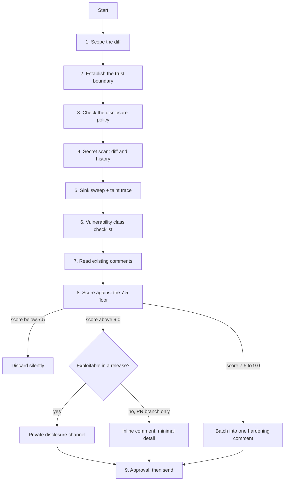

# Security Review

A specialised lens on [`pr-review`](https://github.com/priyank766/OpenSource-SKILL/blob/main/skills/pr-review/SKILL.md): the same diff, read only for the
question *what can an attacker make this code do?*

**Read first:** [`DETECTION-PLAYBOOK.md`](references/DETECTION-PLAYBOOK.md) ·
[`QUALITY-FILTER.md`](references/QUALITY-FILTER.md) ·
[`REVIEW-VOICE.md`](references/REVIEW-VOICE.md)

> **Where the time goes.** Finding the flaw is the review. The playbook above is the
> general flaw-hunting procedure; this file is the domain-specific lens on top of it.
> Scoring and writing the comment are the last ten minutes, not the work.

**Severity floor: 7.5** — lower than the suite default of 8.0. The cost of a miss is
asymmetric. A false negative ships a CVE that outlives the release and lands on the
maintainer as an unplanned patch cycle. A false positive costs the author five minutes to
read and dismiss. When the two errors are that unequally priced, you lower the floor.

The floor does not license volume. Everything under 9.0 is still batched into one comment.

---

## Why this exists

Security findings are where generic AI review is at its worst. It flags `eval` in a comment
string, misses the `os.path.join` two lines below that accepts a user-supplied filename, and
then posts both with identical confidence. Maintainers learn to skim security feedback,
which is exactly the feedback they cannot afford to skim.

This skill trades breadth for a traceable argument: source → sink → why the sanitiser in
between does not hold.

### What each role gets out of it

| Role | Time this gives back |
| :--- | :--- |
| **Maintainer** | The security pass you keep deferring, done in one read. Each finding arrives with the taint path already traced, so you spend your time on the fix, not on reproducing the reviewer's reasoning. Non-exploitable hardening arrives as one batched comment instead of eleven. |
| **Contributor** | A pre-submit check on the classes maintainers actually reject for — shell interpolation, path joins, deserialization — so review is one round instead of three. |
| **Project owner** | Exploitable findings never land in a public thread by accident. The skill checks for `SECURITY.md` and private reporting *before* drafting, so disclosure policy is enforced by procedure rather than by memory. |

---

## Procedure



### 1. Scope the diff

```bash
gh pr checkout <PR>
git diff upstream/main...HEAD                      # three dots, always
git diff --stat upstream/main...HEAD               # sets the comment budget
git diff --name-only upstream/main...HEAD | grep -Ei \
  'auth|login|session|token|crypt|password|perm|acl|upload|parse|exec|shell|path|url'
```

Three dots. Two dots pulls in everything merged to `main` since the branch point, and you
will spend an hour auditing code the contributor never touched.

### 2. Establish the trust boundary

Before reading a single line for bugs, write down in one sentence: *where does data from
outside this process enter the changed code?* HTTP handler, CLI arg, env var, config file,
message queue, webhook, uploaded archive, database row written by another tenant. If you
cannot name the entry point, you cannot classify the finding, and an unclassified security
comment is noise.

### 3. Check the disclosure policy — before you write anything

```bash
ls SECURITY.md .github/SECURITY.md docs/SECURITY.md 2>/dev/null
gh api /repos/<OWNER>/<REPO>/private-vulnerability-reporting --jq '.enabled'
gh api /repos/<OWNER>/<REPO> --jq '.security_and_analysis'   # null unless you have admin
```

`.enabled == true` from `/private-vulnerability-reporting` means private vulnerability
reporting is on and you have a channel. Note that a `200` from `/security-advisories` proves
nothing — that endpoint answers for any repo you can read, empty list included. `false` (or
an error) plus no `SECURITY.md` means you must ask the maintainer where to send it — not
post it. See
[Responsible disclosure](#responsible-disclosure) below; that section overrides everything
else in this file.

### 4. Secret scan — diff and history

A secret removed in a later commit is still in the objects and still compromised.

```bash
# added lines only
git diff upstream/main...HEAD -U0 | grep -E '^\+' | grep -Ei \
  '(api[_-]?key|secret|passwd|password|token|private[_-]key|BEGIN [A-Z ]*PRIVATE KEY|AKIA[0-9A-Z]{16}|gh[pousr]_[A-Za-z0-9]{36}|xox[baprs]-)'

# was it ever committed, even if deleted since?
git log -p -S 'AKIA' --oneline -- .
git log -p -S 'BEGIN RSA PRIVATE KEY' --oneline -- .

# fixtures and .env are the usual leak sites
git diff --name-only upstream/main...HEAD | grep -Ei '\.env|secret|credential|\.pem|\.p12'
```

If a live credential is in history, that is a disclosure-channel finding and a rotation
request, not a review comment. Deleting the line does not fix it.

### 5. Sink sweep, then trace backwards

Grep for sinks first — they are a short list. Then trace each hit backwards to a source.
Reversing the order means reading every line for nothing.

```bash
git diff upstream/main...HEAD -U0 | grep -E '^\+' | grep -nE \
  'exec|system|popen|spawn|shell=True|child_process|Runtime\.getRuntime|eval|Function\(|pickle\.loads?|yaml\.load|Marshal\.load|ObjectInputStream|innerHTML|dangerouslySetInnerHTML|document\.write|os\.path\.join|filepath\.Join|path\.join|ZipFile|tarfile|requests\.(get|post)|http\.Get|fetch\(|axios\.|urllib'
```

A sink with a literal argument is fine. A sink whose argument is a variable is a question:
where did that variable come from, and what happens between there and here?

### 6. Run the class checklist

[Below](#vulnerability-class-checklist). Skip classes the diff cannot reach — a change to a
CLI flag parser does not need a CSRF pass.

### 7. Read what has already been said

```bash
gh api /repos/<OWNER>/<REPO>/pulls/<PR>/comments \
  --jq '.[] | "\(.user.login) | \(.path):\(.line) | \(.body[0:150])"'
gh pr checks <PR>     # CodeQL, Semgrep, Snyk may already own this finding
```

If CodeQL flagged it, do not restate it. Add only what the scanner could not know — that the
sanitiser upstream is bypassable, or that the flagged path is unreachable.

### 8. Score, then route

Score against the [10-point filter](references/QUALITY-FILTER.md) at the 7.5 floor, then
route by exploitability, not by score alone. Routing is step 8 and it is not optional.

---

## Taint-tracing audit

A finding is only real if you can name the source, the sink, and the absent or bypassable
control between them. If any of the three is a guess, the finding does not ship.

| Source (untrusted) | Reaches sink | Becomes |
| :--- | :--- | :--- |
| HTTP query / body / header / cookie | shell exec | command injection |
| Path or route segment | path join, `open`, `sendFile` | path traversal |
| Uploaded filename, archive entry name | extract-to-disk | zip-slip, arbitrary write |
| Request body (JSON, form, msgpack) | deserializer | RCE via object construction |
| User-supplied URL or hostname | HTTP client, redirect, webhook | SSRF, open redirect |
| Search / filter parameter | SQL, NoSQL query, ORM raw | SQL / operator injection |
| Profile field, comment text | template render, `innerHTML` | XSS |
| Env var, CLI arg (in a service context) | config, exec | privilege / config injection |
| Any of the above | log line, error message | secret and PII leakage |

### Same trace, three languages

**Python — HTTP param to shell**

```python
# source: request.args  → sink: shell
subprocess.run(f"convert {request.args['file']} out.png", shell=True)   # injectable
subprocess.run(["convert", safe_name, "out.png"], shell=False)          # argv, no shell
```

**TypeScript — request body to path**

```ts
// source: req.body.name → sink: fs path
fs.readFileSync(path.join(BASE, req.body.name));                  // "../../etc/passwd"
const p = path.resolve(BASE, req.body.name);
if (!p.startsWith(BASE + path.sep)) throw new Error("bad path");  // resolve, then confine
```

**Go — user URL to HTTP client**

```go
// source: r.FormValue → sink: outbound request  (SSRF to 169.254.169.254)
resp, _ := http.Get(r.FormValue("target"))

u, err := url.Parse(r.FormValue("target"))
if err != nil || !allowedHosts[u.Hostname()] || u.Scheme != "https" {
    return errForbiddenTarget                  // allow-list the host, then dial
}
```

The pattern is identical across all three: the fix is never "escape the input", it is
"remove the interpreter" — argv instead of a shell string, resolve-and-confine instead of
join, allow-list instead of blocklist.

---

## Vulnerability class checklist

Each row: what to grep for, how it fails, what safe looks like.

**Command injection** — `shell=True`, `os.system`, `exec(`, `child_process.exec`,
backticks, `Runtime.getRuntime().exec(String)`. Fails when any argument is interpolated;
quoting is not a fix because `$(…)` survives quoting in the wrong context. Safe: argv arrays
with the shell disabled. If a shell is genuinely required, the variable must be a validated
enum, not an escaped string.

**SQL / NoSQL injection** — string concatenation or f-strings near `SELECT`, `WHERE`,
`.raw(`, `$where`, `$regex`, `execute(`. Fails on parameterisation gaps and on Mongo
operator injection when a JSON body value is passed straight into a filter. Safe:
placeholders for values; a hard-coded allow-list for identifiers and sort columns, which
cannot be parameterised; type-coerce query params before they enter a Mongo filter.

**Template injection** — user data passed as the *template* rather than as *data*:
`Template(user_input)`, `render_template_string`, `eval`-backed templating. Safe: templates
are static assets, user data is only ever context.

**Path traversal and zip-slip** — `path.join`/`filepath.Join`/`os.path.join` with a
non-literal segment; `ZipFile.extractall`, `tarfile.extractall`, any archive loop. Fails on
`../`, on absolute paths (which silently discard the base in `os.path.join`), on symlink
entries inside archives, and on URL-decoded traversal. Safe: resolve to an absolute real
path, assert it is inside the base directory *including the trailing separator*, reject
absolute and symlink entries before writing. Python 3.12+: `extractall(filter="data")`.

**Unsafe deserialization** — `pickle.load(s)`, `yaml.load` without `SafeLoader`,
`Marshal.load`, `ObjectInputStream.readObject`, `unserialize()`, `JSON.parse` piped into a
prototype-mutating merge. Fails as direct RCE, not as data corruption. Safe: a data-only
format (JSON, protobuf) with an explicit schema; `yaml.safe_load`; for pickle, a signed
envelope or a different design.

**SSRF and URL handling** — `requests.get(url)`, `fetch(url)`, `http.Get`, webhook
callbacks, "import from URL" features, image-by-URL fetchers. Fails against
`169.254.169.254`, `127.0.0.1`, `[::1]`, `file://`, `gopher://`, DNS rebinding, and
redirects that leave the allow-list. Safe: allow-list scheme and host, resolve the hostname
and reject private and link-local ranges, disable or re-validate redirects, and set a
timeout.

**Open redirect** — `redirect(request.args['next'])`. Safe: relative paths only, or an
allow-list of destinations.

**Authn / authz gaps** — the highest-value class and the one grep finds worst. Read every
new route and handler and ask three questions. *Is there a check at all* — a new endpoint
added next to decorated ones but missing the decorator is the single most common real
finding. *Does the check cover the object* — `if user.is_authenticated` followed by
`Order.get(request_id)` with no ownership test is IDOR. *Is the check still true at use
time* — permission read, then acted on after an await or a second query, is TOCTOU. Safe:
authorization enforced at the data-access layer (scoped queries: `Order.where(user_id:
current_user.id)`), not at the routing layer where it can be forgotten.

**Crypto misuse** — `MODE_ECB`, a hard-coded or reused IV/nonce, `md5`/`sha1` used for
passwords, `==` comparing tokens or MACs, `random`/`math/rand`/`Math.random` generating
tokens, `verify=False`, `InsecureSkipVerify: true`, custom key derivation. Failure modes in
order: ECB leaks plaintext structure; a static IV destroys semantic security and, for
CTR/GCM, leaks the keystream; fast hashes make password cracking cheap; `==` is
timing-observable; non-CSPRNG tokens are predictable. Safe: an AEAD (AES-GCM,
ChaCha20-Poly1305) with a per-message random nonce; argon2id/scrypt/bcrypt for passwords;
`hmac.compare_digest` / `crypto.timingSafeEqual` / `subtle.ConstantTimeCompare`;
`secrets.token_urlsafe` / `crypto.randomBytes` / `crypto/rand` for tokens.

**Secrets in code, logs, and errors** — see step 4 for the diff scan. Also read the new
logging and error-handling lines: `log.info(f"auth {token}")`, exception messages echoing a
connection string, debug endpoints dumping the environment, tracebacks returned to the
client. Safe: log an identifier, never the credential; redact at the logger, not at each
call site.

**XSS and unsafe HTML sinks** — `innerHTML`, `outerHTML`, `dangerouslySetInnerHTML`,
`document.write`, `v-html`, `|safe`, `mark_safe`, `template.HTML(...)` in Go. Fails when the
value crossed a trust boundary at any point, including a round-trip through the database.
Safe: text nodes and framework auto-escaping; if HTML really must be rendered, sanitise with
a maintained library (DOMPurify, bluemonday) at render time, not at input time.

**CSRF and cookie flags** — new state-changing routes exempted from CSRF middleware,
`csrf_exempt`, cookies set without `HttpOnly`, `Secure`, `SameSite`. Fails when a
cookie-authenticated POST can be triggered cross-origin. Safe: keep the middleware,
`SameSite=Lax` minimum on session cookies, and `HttpOnly` unless JS provably needs the
value.

**ReDoS** — new regexes containing nested quantifiers (`(a+)+`, `(\w*\s*)*`) or
alternation-with-overlap, applied to unbounded user input. Safe: bound the input length,
flatten the pattern, or use a linear-time engine (RE2, `regexp` in Go is already linear).

**File races** — `os.path.exists` then `open`, `tempfile.mktemp`, predictable paths in
`/tmp`, `chmod` after create, extraction that follows symlinks. Fails when a local attacker
wins the window between check and use. Safe: `mkstemp`/`TemporaryDirectory`, `O_EXCL |
O_NOFOLLOW`, set the mode at creation time, and act on file descriptors rather than paths.

**Dependencies and supply chain** — new packages, lockfile churn, changed CI workflows,
`pull_request_target`, unpinned actions. Out of scope here; hand off to
[`dependency-review`](https://github.com/priyank766/OpenSource-SKILL/blob/main/skills/dependency-review/SKILL.md).

---

## Severity calibration

| Finding | Band | Action |
| :--- | :---: | :--- |
| Unauthenticated RCE, auth bypass, SQL injection on a reachable route, secret committed live | **10** | Private disclosure. Never a public comment. |
| Stored XSS, IDOR on tenant data, SSRF reaching cloud metadata, path traversal with write | **9.5** | Private if released; inline with minimal detail if the code is new on this branch. |
| Weak crypto on real data (ECB, static IV, MD5 passwords), non-constant-time token compare | **9.0–9.5** | Inline, with the patch. |
| Missing `SameSite`/`HttpOnly`, missing timeout on an outbound call, ReDoS on bounded input | **8.0–8.9** | Inline, one comment, collaborative framing. |
| Real but unexploitable hardening — defence in depth, an unreachable sink, a redundant check | **7.5–8.0** | **One batched comment** covering all of them. Never one thread each. |
| Theoretical issue with no named source, scanner output you did not verify, "consider adding rate limiting" | **< 7.5** | Drop. Silently. |

The explicit rule: **unexploitable-but-real hardening scores 7.5–8.0 and gets exactly one
batched comment for the whole review. Anything you can demonstrate an attacker reaching
scores 9.5+ and goes through the routing decision in step 8.** Six hardening notes do not
add up to a critical finding; they add up to one comment listing six lines.

---

## Responsible disclosure

**Hard rule: if the finding is exploitable against the deployed or released project, do not
post it as a public PR comment.** A public comment on a live vulnerability is a zero-day
announcement with a permalink, published before a fix exists, on a repo whose maintainer may
be asleep in another timezone.

Decide with one question: *does this code, or code equivalent to it, exist in a released
version or on the default branch?*

- **Yes** → private channel. No exceptions, no "I'll be vague about it".
- **No — the vulnerable line is new on this PR branch** → an inline comment is fine, because
  nothing is exposed yet. Even then, describe the fix, not the attack. "This needs to be an
  argv array" is enough; a working payload is not.

### Find the channel

```bash
ls SECURITY.md .github/SECURITY.md docs/SECURITY.md 2>/dev/null
gh api /repos/<OWNER>/<REPO>/private-vulnerability-reporting --jq '.enabled'  # true = on
gh api /repos/<OWNER>/<REPO> --jq '.security_and_analysis'   # null unless you have admin
```

Order of preference: the channel named in `SECURITY.md` → GitHub private vulnerability
reporting (repo → Security → Report a vulnerability) → the maintainer's published security
address. If none exists, post a public comment saying only *"found something I'd rather not
describe here — is there a private channel?"* and stop.

### Private report template

```markdown
**Component:** src/importer/fetch.py, introduced in PR #412
**Class:** SSRF — user-supplied URL reaches an outbound HTTP client with no host allow-list
**Affected:** main @ <sha>, and v2.3.0+ if the same path exists there

**Path:** POST /api/import  →  body.source_url  →  requests.get(url) (fetch.py:88).
No scheme or host validation; redirects followed by default.

**Impact:** a request to http://169.254.169.254/... returns cloud instance credentials in
the response body shown to the caller.

**Suggested fix:** allow-list scheme and host, resolve the hostname and reject private and
link-local ranges, and set allow_redirects=False.

I have not tested this against any hosted instance. Happy to review the patch. Let me know
your preferred disclosure timeline.
```

No PoC script. No payload beyond the minimum needed to identify the class.

---

## Worked examples

### Shell interpolation in a new CLI subcommand (post publicly — new code)

**AI baseline (6.5/10)**
> Using `shell=True` is a security risk and is not a best practice. Consider using
> subprocess with a list of arguments to ensure that user input is handled safely.

**Maintainer-grade (9.5/10)**
> `--out` lands in a shell string here, so a filename like `x; rm -rf ~` runs. Passing argv
> with the shell off keeps it a single token:
> ```python
> subprocess.run(["convert", args.src, "-resize", size, args.out], check=True)
> ```
> Same shape as `thumbnail.py:41`. This is new on the branch so nothing's exposed yet.

### Token comparison in a released auth path (do NOT post — disclose)

**Raw observation:** `webhook.py:52` compares the HMAC with `if sig == expected:`, and the
same code is in v2.3.0.

**Evaluation:** Correctness 10, Impact 9, Necessity 9, Empathy 8 → **9.1**. Above the floor,
and exploitable against a released version.

**Action: do not comment inline.** Route to the private channel using the template above,
with the fix attached:

```python
if not hmac.compare_digest(sig, expected):
    abort(403)
```

Public thread gets nothing — not even "there's a subtle issue in the signature check here",
which is a pointer for anyone reading the repo.

### An idea that should be dropped entirely

**Raw observation:** the new `/health` endpoint has no rate limiting.

**Evaluation:** No named source of harm, no state change, no data returned, and the project
sits behind a reverse proxy that already rate-limits. Correctness 6, Impact 3, Necessity 2,
Empathy 5 → **4.1**.

**Action: drop.** Not in the summary, not as "a minor note". Speculative hardening on an
endpoint you have not shown to be reachable is the exact noise that trains maintainers to
skim security review.

---

## Explicitly out of scope

- **Writing exploits or weaponised PoCs.** Identify the class and the fix. A minimal
  reproduction may be described in a private report if the maintainer asks; do not build
  working attack tooling.
- **Scanning or probing third-party infrastructure.** Read the diff. Do not send traffic to
  anyone's deployment, including the project's own hosted instance.
- **CVE-number speculation.** Do not assert "this is CVE-2023-XXXXX" or predict a CVSS
  score. Describe the behaviour; assignment is the maintainer's call.
- **License, lockfile, and supply-chain analysis.** →
  [`dependency-review`](https://github.com/priyank766/OpenSource-SKILL/blob/main/skills/dependency-review/SKILL.md).
- **General correctness, performance, and test quality.** →
  [`pr-review`](https://github.com/priyank766/OpenSource-SKILL/blob/main/skills/pr-review/SKILL.md), [`performance-review`](https://github.com/priyank766/OpenSource-SKILL/blob/main/skills/performance-review/SKILL.md),
  [`test-review`](https://github.com/priyank766/OpenSource-SKILL/blob/main/skills/test-review/SKILL.md).

---

## Pre-post checklist

- [ ] Diff isolated with `base...head`; every target line is actually in the diff.
- [ ] Trust boundary written down: the entry point for untrusted data is named.
- [ ] Every finding has a traced source → sink → missing-control path, not a pattern match.
- [ ] Diff and history scanned for secrets (`git log -p -S`), not just added lines.
- [ ] `SECURITY.md` and private reporting checked **before** drafting any comment.
- [ ] Exploitability against released code decided per finding, and routing follows it.
- [ ] Nothing exploitable in a public thread — no hints, no vague pointers.
- [ ] Existing scanner output (CodeQL, Semgrep) and maintainer comments read; no duplicates.
- [ ] Every posted finding scores 7.5+; all 7.5–8.0 hardening merged into one comment.
- [ ] Patch included as code for each posted finding; no exploit payloads anywhere.
- [ ] Voice checked: no cheerleading, no robotic register, no directives.
- [ ] Explicit user approval obtained before any `gh api` write or private report.
