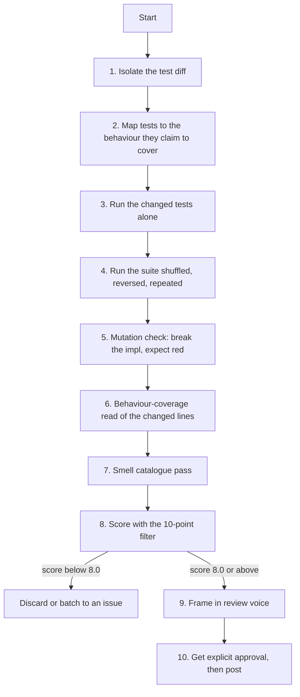

# Test Review

The testing lens of the suite. Layered on top of [`pr-review`](https://github.com/priyank766/OpenSource-SKILL/blob/main/skills/pr-review/SKILL.md) —
that skill's diff isolation, context building and posting rules still apply. This one
replaces the line-by-line audit with a test-specific one.

**Read first:** [`DETECTION-PLAYBOOK.md`](references/DETECTION-PLAYBOOK.md) ·
[`QUALITY-FILTER.md`](references/QUALITY-FILTER.md) ·
[`REVIEW-VOICE.md`](references/REVIEW-VOICE.md)

> **Where the time goes.** Finding the flaw is the review. The playbook above is the
> general flaw-hunting procedure; this file is the domain-specific lens on top of it.
> Scoring and writing the comment are the last ten minutes, not the work.

**Severity floor: 8.0.** Comment budget: one per ~200 changed lines, max 5.

---

## The governing rule

A test has exactly one job: **fail when the behaviour breaks.** Everything else — naming,
structure, arrangement, parametrisation style — is decoration on top of that job, and none
of it clears 8.0 on its own.

The decisive technique is **mutation thinking**. For every test in the diff, break the
implementation in your head and ask whether this test notices. Delete the line the test is
supposedly about. Flip a comparison. Return an empty list instead of the real one. If the
test still passes, it is not a test, it is a ritual — and that finding scores 9.0+ no
matter how clean the test reads.

Do the real version where it is cheap: comment out the implementation line, run the new
test, confirm it fails. Thirty seconds of that outranks any amount of reading. Every
finding in this skill must be justified against the governing rule, in one sentence, before
it is written up. "This test would still pass if X broke" is a finding. "This test could be
named better" is not.

---

## Why this exists

Bad tests are the most expensive thing a PR can add, because their cost is deferred and
paid by someone else. A test that cannot fail contributes nothing but a green tick and a
false sense of cover. A flaky test costs the maintainer a re-run today and a habit of
ignoring red CI within a month — after which the suite stops protecting anything. Both are
nearly free to fix at review time and nearly impossible to fix later, once the test is load
bearing in everyone's mental model of "the suite passes".

Review is the only moment where the fix costs one comment.

### What each role gets out of it

| Role | Time this gives back |
| :--- | :--- |
| **Maintainer** | The flake never lands. No 2 a.m. re-runs, no bisecting a red `main` to a `sleep(0.1)` merged eight months ago, no triage queue of "restarted, passed, closing". |
| **Contributor** | The mutation check before you push, so the first maintainer response is "merged" and not "does this actually test anything?" |
| **Project owner** | A suite whose red means red. Once contributors trust CI, review time drops for every PR, not just this one. |

---

## Procedure



### 1. Isolate the test diff

```bash
git diff --stat upstream/main...pr-<N> -- '**/test*' '**/*_test.go' '**/*.spec.*'
git diff upstream/main...pr-<N> -- tests/ conftest.py           # fixtures matter most
git diff upstream/main...pr-<N> --diff-filter=D -- tests/       # what got deleted
```

Deleted and weakened tests deserve more attention than added ones. An assertion loosened
from `== 3` to `>= 0` inside a large diff is the single highest-value thing to catch.

### 2. Map each test to a behaviour

For every new test, write down in one line the behaviour it pins. If you cannot, the test
is decorative and the mutation check will confirm it. For every non-test line the PR
changes, write down which test covers it. The gaps in that second list are your missing-test
candidates — nothing else is.

### 3. Run only the changed tests

```bash
pytest tests/test_runner.py::test_empty_items -q
go test ./pkg/runner -run 'TestEmptyItems$' -v
npx jest tests/runner.test.ts -t 'empty items'
cargo test --package runner empty_items -- --exact
```

### 4. Run for isolation, order and flake

```bash
pytest                                  # pytest-randomly shuffles by default once installed
pytest -p no:randomly                   # disable it, for the deterministic comparison run
pytest --lf                             # last-failed only, reproduces a partial run
go test ./... -shuffle=on -count=5
npx jest --randomize                    # Jest 29.5+
npx jest --runInBand                    # serial, exposes worker-isolation assumptions
cargo test -- --test-threads=1
```

Reverse order catches setup that silently depends on an earlier test:

```bash
pytest -p no:randomly --reverse         # pytest-reverse
```

Isolation versus suite is the cheapest coupling detector there is — a test that passes
alone and fails in the suite (or the reverse) is leaking state, and that is a 9.0.

Repeat-run to expose timing flakes:

```bash
pytest tests/test_runner.py --count=20  # pytest-repeat
go test ./pkg/runner -count=20 -race
npx jest tests/runner.test.ts --runTestsByPath --maxWorkers=4 # then repeat in a loop
```

### 5. The mutation check

Not optional. This is the step that separates this skill from reading.

```bash
# 1. Confirm the new test passes on the PR head.
pytest tests/test_runner.py::test_retries_on_timeout -q

# 2. Break the implementation it claims to cover — comment out the line,
#    invert the condition, or return a constant.
# 3. Re-run. It must fail.
pytest tests/test_runner.py::test_retries_on_timeout -q

# restore only the file you mutated — never `git checkout -- src/`, which throws away
# every other uncommitted change under src/
git restore --source=HEAD --worktree src/runner.py
```

If step 3 stays green, you have a 9.5 finding and you can state it as fact rather than
opinion: "commenting out the `retry` call on `runner.py:88` leaves this test green."

### 6. Coverage of the changed lines only

```bash
coverage run -m pytest && coverage xml
diff-cover coverage.xml --compare-branch=upstream/main   # only lines this PR touched

go test ./... -coverprofile=c.out && go tool cover -func=c.out
npx c8 --check-coverage=false npm test        # or: npx nyc npm test
```

Read it as a map of which branches are unexercised, not as a number. See the coverage
section below.

### 7–10

Smell pass (next section), then score, frame and post exactly as in
[`pr-review`](https://github.com/priyank766/OpenSource-SKILL/blob/main/skills/pr-review/SKILL.md) steps 6–8.

---

## Test-smell catalogue

Each entry: how it looks in a diff · why it costs someone time · the fix.

**Tautological assertion.** `assert len(result) == len(result)`, `expect(x).toEqual(x)`,
comparing a value to itself through a variable rename, or re-deriving the expected value
with the same function under test. Spot it by checking whether both sides of the assertion
trace back to the same call. It can never fail, so it is pure maintenance weight. Fix:
assert against a literal the reviewer can read — `assert result == [1, 2, 3]`.

**Assertion on the mock, not the behaviour.** `assert mock_client.called` or
`expect(spy).toHaveBeenCalled()` as the *only* assertion. This pins that a call happened,
not that it was correct or that anything came of it. Fix: assert the arguments and the
outcome — `mock_client.send.assert_called_once_with(payload, timeout=30)` plus a check on
what the function returned.

**Over-mocking.** Every collaborator patched, so the test asserts the implementation calls
the functions the implementation calls. Spot it when the mock setup is longer than the code
under test, or when renaming a private helper breaks tests. It converts every refactor into
a test rewrite. Fix: mock the process boundary (network, clock, filesystem) and let the
internals run.

**Passes with the implementation deleted.** The catch-all, found by step 5. Usually caused
by asserting on the mock's own return value, or by a `try/except` that swallows the failure.
Fix: whatever makes it fail against the unpatched code.

**Unread snapshot.** A new `__snapshots__/*.snap`, `testdata/*.golden` or
`toMatchSnapshot()` committed alongside a behaviour change. If the snapshot diff is large
and the PR description does not explain it, nobody checked whether the new output is
correct — the snapshot records the bug. Fix: ask for one explicit assertion on the field
that actually changed, next to the snapshot.

**No negative path.** Every new test asserts success. The error branch the PR just added —
timeout, bad input, permission denied — has no test. This is the most common genuine gap
and usually the only missing test worth asking for.

**Shared mutable fixture / state leakage.** Module-level dicts and lists, a
`@lru_cache` never `.cache_clear()`ed, `os.environ[...]` set without `monkeypatch`,
singletons and global config mutated in a test, a Go package-level `var` written by one
test, a JS module holding state across `import`s. Spot it by grepping the test file for
assignment at module scope, and confirm with the isolation run in step 4. Fix: fixture with
teardown — `monkeypatch.setenv`, `t.Cleanup(func(){ ... })`, `beforeEach`/`afterEach`.

**Order dependence.** Test B only passes after test A created a row, a file or a cached
value. Confirmed by `-shuffle=on`, `--reverse` or running B alone. Fix: B creates its own
fixture; shared setup goes in a per-test fixture, not in another test.

**`sleep()` as synchronisation.** `time.sleep(0.5)` / `await new Promise(r =>
setTimeout(r, 500))` / `time.Sleep(500 * time.Millisecond)` waiting for a worker, a
goroutine or a debounce. Passes locally, fails on a loaded CI runner, and slows the suite
for everyone forever. Fix: wait on the event, not the clock — `threading.Event.wait()`,
`sync.WaitGroup`, a channel, fake timers (`jest.useFakeTimers()`), or a polling helper with
a timeout.

**Other flake sources.** Real network calls (a test that fails when a laptop is offline);
`datetime.now()` / `time.Now()` without injection, so the test breaks at a month boundary or
during DST; real filesystem writes to a fixed path; `random` without a seed; assumptions
about the machine's timezone or locale; binding a hardcoded port. Fix in order of
preference: inject the dependency, fake it, or bind port `0` and read back the assigned one.

**Non-deterministic iteration order.** Asserting a list built from a `set`, a Go `map`
range, or `os.listdir()`. Green until the day it is not. Fix: sort before asserting, or
compare as a set.

**Hardcoded absolute path.** `/home/alice/repo/testdata`, `/tmp/out.json`, `C:\...`. Fails
for every other contributor and in CI containers. Fix: `tmp_path`, `t.TempDir()`,
`os.tmpdir()`, or a path relative to the test file.

**Asserting on log strings or exception messages.** `assert "connection failed" in caplog.text`
or matching an exception's prose. The message is not the contract; rewording it turns a
docs change into a test failure. Fix: assert on the exception type and its structured
fields, or on the error code.

**Overly broad exception matching.** `pytest.raises(Exception)`, `expect(...).toThrow()`
with no argument, `assert err != nil` alone. Passes on a typo in the test setup. Fix: name
the exact type, and check a field: `pytest.raises(TimeoutError)`,
`errors.Is(err, ErrTimeout)`.

**Parametrisation that hides the failing case.** A loop over cases inside one test function,
so CI reports "test_validate failed" and nothing else. Fix: `@pytest.mark.parametrize` with
`ids=`, table tests with `t.Run(tc.name, ...)`, `it.each` with a `%s` title.

**Slow test in the fast suite.** A new test that takes seconds — real container start, large
fixture, retry loop with real backoff. Multiply by every contributor on every push. Fix:
mark and exclude it (`@pytest.mark.slow`, a build tag, a separate CI job).

**Skip / xfail with no linked issue.** `@pytest.mark.skip("flaky")`, `t.Skip()`,
`it.skip(...)`, `#[ignore]` added in this PR. Without a tracking link it is permanent. Fix:
either the reason and an issue link, or `xfail(strict=True)` so it reports when it starts
passing.

---

## Coverage

Coverage percentage is not a review finding. **"Coverage dropped 0.3%" is never a postable
comment** — it is a bot's job, it carries no information about risk, and it teaches
contributors to write tests that touch lines rather than tests that assert behaviour. A
file can sit at 100% line coverage with zero real assertions.

What is worth saying is behaviour coverage, stated specifically:

- Which branches of the *new* code are exercised? Use `diff-cover` or a coverage report
  filtered to the changed lines, and read the uncovered ones by hand.
- Which error paths are not? A newly added `except`, `if err != nil`, `catch`, or retry
  branch with no test is the finding — not the percentage that reflects it.
- Is the covered line merely *executed*, or is its effect asserted? A line runs during
  setup and shows as covered while nothing checks its result.

Post `runner.py:104 — the ConnectionError branch this PR adds isn't hit by any test`, never
`coverage on this file went from 82% to 79%`.

---

## When to ask for a missing test — and how

Ask only when the PR changes behaviour that could **silently** regress: a bug fix with no
test that reproduces the bug, a new error or retry path, a boundary the change now handles
differently, a security-relevant check.

Name the case. "Please add tests" transfers your work to the author and gets a shrug:

> A case where `items` is empty would pin this — before the change it returned `None` and
> now it returns `[]`, and nothing in the suite would catch that flipping back:
> ```python
> def test_returns_empty_list_for_no_items():
>     assert collect([]) == []
> ```
> WDYT?

**Counter-rule.** Do not ask for tests on typo fixes, comment or docstring edits, README and
docs changes, formatting, or pure config. Demanding a test for a one-character change is the
clearest signal in a review that nobody read the diff. If the change cannot regress
silently, there is nothing to pin.

---

## Scoring calibration for this domain

| Finding | Score | Action |
| :--- | :---: | :--- |
| Test cannot fail — passes with the implementation deleted or removed | **9.5** | Post, with the mutation result stated as fact |
| Cross-test state leak, order dependence, uncleared cache or env var | **9.0** | Post, with the reproducing command |
| Flake source — `sleep()`, real clock, real network, unseeded random, fixed port | **9.0** | Post, with the deterministic alternative |
| Assertion only on a mock, no behavioural assertion | **8.5** | Post with the patch |
| No test for an error path this PR introduces | **8.5** | Post, naming the exact case |
| Broad `pytest.raises(Exception)` / bare `toThrow()` on a new test | **8.0** | Post, one line |
| Skip or xfail added with no linked issue | **8.0** | Post, ask for the link |
| Test naming, file placement, arrange-act-assert layout, fixture style | **< 6.0** | Reject silently |
| Coverage percentage moved | **< 6.0** | Reject silently |

---

## Worked examples

### A test that cannot fail

**AI baseline (6.0/10)**
> Great test coverage! Consider also asserting on the return value to make the test more
> comprehensive.

**Maintainer-grade (9.5/10)**
> This one stays green with `_apply_retry` commented out — the only assertion is on the mock
> we configured ourselves, so it's asserting our own setup. Asserting the returned value
> makes it fail:
> ```python
> result = client.fetch("/items")
> assert mock_transport.send.call_count == 3
> assert result.status == 200          # currently unasserted
> ```

### Env var leaking into the rest of the suite

**AI baseline (6.5/10)**
> It would be a best practice to clean up environment variables after the test to ensure
> test isolation.

**Maintainer-grade (9.0/10)**
> `REGION` stays set for everything after this — `pytest -p randomly` puts
> `test_default_region` after it and that one fails. `monkeypatch` reverts it at teardown,
> same as `conftest.py` does for `API_TOKEN`:
> ```python
> def test_region_override(monkeypatch):
>     monkeypatch.setenv("REGION", "eu-west-1")
> ```

### A finding that should not be posted

**Raw observation:** the three new table-test cases in `runner_test.go` are named `case1`,
`case2`, `case3`, and the file would read better with the fixture moved above the tests.

**Evaluation:** the cases do run under `t.Run`, so a failure still names the subtest. Nothing
can break. Correctness 9, Impact 3, Necessity 2, Empathy 6 → **5.2/10**.

**Action: skip.** Not in the summary either. Naming preferences on someone else's tests are
the cheapest possible comment to write and the most expensive to receive.

---

## Pre-post checklist

- [ ] Changed tests run in isolation and as part of the full suite; both pass.
- [ ] Suite run shuffled (`-shuffle=on` / `pytest -p randomly` / `jest --randomize`) and in
      reverse; no new failures.
- [ ] Repeat run (`-count=20`, `--count=20`) with `-race` where the language has it.
- [ ] Ran the new test against the unpatched implementation and confirmed it fails.
- [ ] Every non-test line the PR changes is mapped to a test, or listed as a real gap.
- [ ] Coverage read as branches on the changed lines only — no percentage in any comment.
- [ ] Missing-test asks name the specific case and include the test body.
- [ ] No test requested for docs-only, comment-only, typo or config-only changes.
- [ ] Every comment scored 8.0 or above; naming and layout nits dropped silently.
- [ ] Voice checked: no cheerleading, patch included, mutation evidence stated as fact.
- [ ] Explicit user approval obtained before posting.
